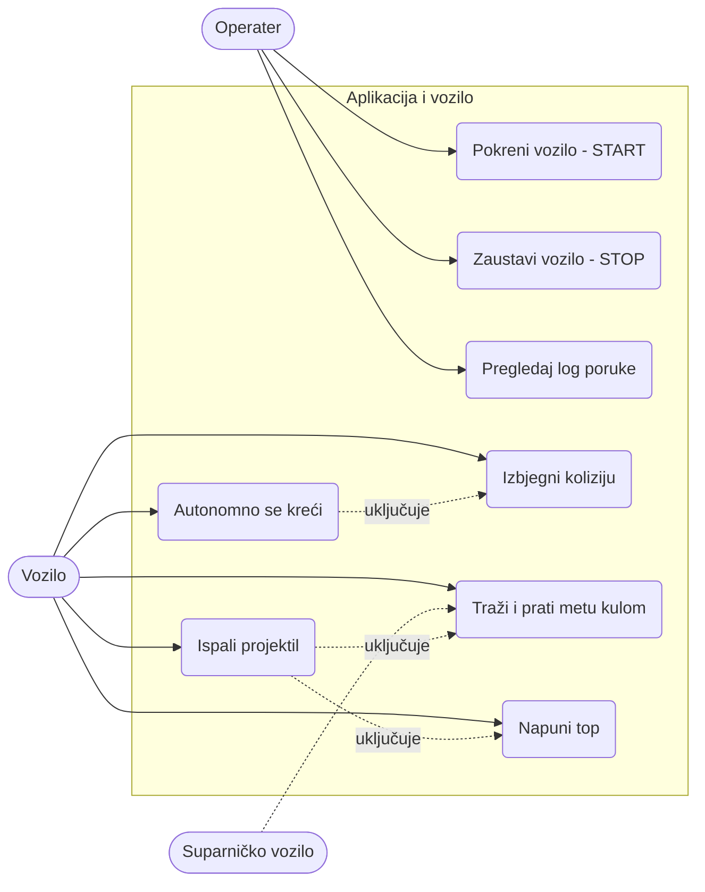

# Specifikacija zahtjeva (Requirements specification)

**Projekat:** Autonomna mobilna platforma sa integrisanim elektromagnetskim topom
**Verzija:** 0.8 (nacrt)
**Napomena:** Vrijednosti označene sa **TBD** treba potvrditi sa profesorom ili mjerenjem.

---

## 1. Uvod

### 1.1 Svrha dokumenta
Dokument opisuje šta autonomno vozilo na JoyCar platformi mora da radi i koja ograničenja ima. Služi kao polazna tačka za projektovanje hardvera, firmvera i aplikacije.

### 1.2 Opis sistema
Sistem se sastoji od:
- **vozila** na JoyCar platformi (motori i JoyCar ploča sa drajverima motora) i naše upravljačke ploče (PCB) koja JoyCar ploči zadaje komande kretanja,
- **okretne kule (turret)** sa servo motorom SG90, na kojoj su **elektromagnetski top**, **meta** i **senzor udaljenosti za metu**,
- **senzora udaljenosti za prepreke** (ultrazvučni HC-SR04), fiksiranog nisko na šasiji,
- **WiFi modula** za komunikaciju,
- **PC aplikacije** za pokretanje, zaustavljanje i prijem log poruka.

Vozilo autonomno traži i gađa **pokretnu metu** na suparničkom vozilu istog tipa.

### 1.3 Definicije
| Pojam | Značenje |
|---|---|
| Senzor udaljenosti | Senzor za mjerenje udaljenosti (HC-SR04 ili IR modul; u zadatku se naziva ToF senzor) |
| Kula (turret) | Okretni dio na vozilu sa topom, metom i senzorom za metu |
| Coilgun | Elektromagnetski top |
| Meta | Površina na suparničkom vozilu koja se gađa, viša od prepreka na polju |
| Log poruka | Tekstualna poruka koju vozilo šalje aplikaciji |
| MCU | Mikrokontroler |

### 1.4 Učesnici
- **Operater:** pokreće i zaustavlja vozilo i prati logove.
- **Vozilo:** autonomno izvršava zadatak.
- **Suparničko vozilo:** pokretna meta i prepreka.

---

## 2. Funkcionalni zahtjevi

### 2.1 Upravljanje vozilom i kretanje
| ID | Zahtjev |
|---|---|
| FR-01 | Vozilo se kreće autonomno nakon komande START i zaustavlja se na komandu STOP. |
| FR-02 | Ploča upravlja kretanjem (naprijed, nazad, skretanje, zaustavljanje) slanjem komandi JoyCar ploči, koja sadrži drajvere motora. |

### 2.2 Detekcija prepreka i kontrola kolizije
| ID | Zahtjev |
|---|---|
| FR-03 | Vozilo ima dva senzora udaljenosti: **nisko postavljen na šasiji** za prepreke i **na kuli** za metu. Meta je viša od prepreka, pa senzor na kuli ne reaguje na prepreke. |
| FR-04 | Kada senzor na šasiji detektuje prepreku bližu od praga (**TBD** mm), vozilo se zaustavlja ili je zaobilazi. Izbjegavanje prepreke ima prioritet nad drugim komandama kretanja. |

### 2.3 Detekcija i praćenje mete
| ID | Zahtjev |
|---|---|
| FR-05 | Vozilo traži metu okretanjem kule (po potrebi i kretanjem vozila, **TBD**) i detektuje je senzorom na kuli. |
| FR-06 | Kada je meta detektovana, kula se okreće dok meta nije u liniji topa. Top i senzor su na kuli u istom smjeru, pa je poravnanje senzora ujedno i poravnanje topa. |
| FR-12 | Kulu okreće servo motor SG90 u opsegu od **TBD** stepeni, a ploča zadaje željeni ugao. |

### 2.4 Elektromagnetski top
| ID | Zahtjev |
|---|---|
| FR-07 | Ploča puni kondenzatore topa do radnog napona (**TBD** V) i mjeri njihov napon. |
| FR-08 | Top ispaljuje projektil kada je meta poravnata i kondenzator napunjen, uz minimalni razmak između ispaljivanja (**TBD** s). |

### 2.5 Komunikacija i aplikacija
| ID | Zahtjev |
|---|---|
| FR-09 | Vozilo se povezuje na WiFi mrežu i uspostavlja vezu sa aplikacijom. |
| FR-10 | Aplikacija ima komande **START** i **STOP**. |
| FR-11 | Vozilo šalje log poruke (stanje, udaljenost, ispaljivanje, greške), a aplikacija ih prikazuje u realnom vremenu. |

### 2.6 Stanja sistema
Sistem radi kao **dvije nezavisne mašine stanja**, koje rade istovremeno. Komanda START pokreće obje, a STOP ih vraća u stanje IDLE.

**Vozilo (šasija)**, koristi senzor na šasiji i upravlja motorima:

`IDLE → DRIVE ⇄ AVOID`

- DRIVE: vozilo se kreće.
- AVOID: prepreka je bliža od praga, pa se vozilo zaustavlja ili je zaobilazi, a zatim se vraća u DRIVE.

**Meta i top**, koristi senzor na kuli i upravlja kulom i topom:

`IDLE → SEARCH → TRACK → FIRE → SEARCH`

- SEARCH: kula se okreće i traži metu.
- TRACK: meta je pronađena, kula se okreće dok nije poravnata sa topom. Ako se meta izgubi, vraća se u SEARCH.
- FIRE: meta je poravnata i kondenzator napunjen, pa top ispaljuje projektil, a zatim se vraća u SEARCH.

Mašine su nezavisne jer upravljaju različitim dijelovima (motori i kula). Ako mašina mete traži i kretanje vozila (**TBD**), stanje AVOID ima prioritet nad tom komandom. Kondenzator se puni u pozadini, a minimalni razmak između ispaljivanja je uslov u zahtjevu FR-08.

---

## 3. Nefunkcionalni zahtjevi

### 3.1 Performanse
| ID | Zahtjev |
|---|---|
| NFR-01 | **Odziv:** reakcija na prepreku u roku od **TBD** ms, izvršenje STOP komande u roku od **TBD** ms, a vrijeme od detekcije mete do ispaljivanja je najviše **TBD** s. |
| NFR-02 | **Tačnost:** efektivni domet i procenat pogodaka određuju se mjerenjem (**TBD**). |

### 3.2 Sigurnost
| ID | Zahtjev |
|---|---|
| NFR-03 | **Sigurnost:** napon kondenzatora je ograničen (**TBD**), uz automatsko pražnjenje i prekidač za isključenje. Ispaljivanje nije moguće bez potvrđenog punjenja. |

### 3.3 Pouzdanost i otpornost na greške
| ID | Zahtjev |
|---|---|
| NFR-04 | **Failsafe:** pri gubitku WiFi veze vozilo se zaustavlja, a top se razoružava. |
| NFR-05 | **Pouzdanost:** greške se bilježe i šalju kao log poruke, a firmver koristi watchdog timer. |

### 3.4 Hardverska ograničenja
| ID | Zahtjev |
|---|---|
| NFR-06 | **Hardver:** ploča se uklapa u JoyCar platformu (dimenzije, konektori), dvoslojna je i izrađena u KiCadu. Cijeli sistem se napaja iz 4 × AA baterija, a ploča koristi napone 3v3, 5V i V_BAT sa zaglavlja JoyCar ploče, bez vlastitih regulatora. Komunikacija sa JoyCar pločom i nivoi signala usklađuju se prema njenoj dokumentaciji (**TBD**). |

### 3.5 Softverska ograničenja i održivost
| ID | Zahtjev |
|---|---|
| NFR-07 | **Firmver:** modularan (WiFi, senzori udaljenosti, motori, kula, top, mašine stanja), dokumentovan Doxygen komentarima. |
| NFR-08 | **Aplikacija:** radi na standardnom PC-u (**TBD**) i prikazuje samo START, STOP i prozor sa logovima. |
| NFR-09 | **Održivost:** projekat je u Git repozitoriju, a podešavanja (WiFi, IP, pragovi) u jednoj konfiguracionoj datoteci. |

### 3.6 Okruženje
| ID | Zahtjev |
|---|---|
| NFR-10 | **Okruženje:** rad u zatvorenom prostoru, na ravnoj podlozi, uz stabilnu WiFi mrežu. |

---

## 4. Format log poruka (prijedlog)

```
[vrijeme s] NIVO modul: poruka
[12.4s] INFO  STATE=TRACK dist=830mm
[13.1s] INFO  FIRE
[13.2s] ERROR CAP voltage low
```

Komande aplikacije: `START\n`, `STOP\n`. Poruke se završavaju znakom novog reda.

---

## 5. Use-case dijagram



---


## 7. Praćenje (traceability)

| Funkcionalnost iz zadatka | Zahtjevi |
|---|---|
| Autonomno vozilo na JoyCar platformi | FR-01, FR-02 |
| Pozicioniranje i gađanje pokretne mete | FR-05, FR-06, FR-08, FR-12 |
| Elektromagnetski top | FR-07, FR-08 |
| Upravljanje vozilom, kontrola kolizije, senzori udaljenosti | FR-02, FR-03, FR-04 |
| WiFi: START/STOP i log poruke | FR-09, FR-10, FR-11 |
