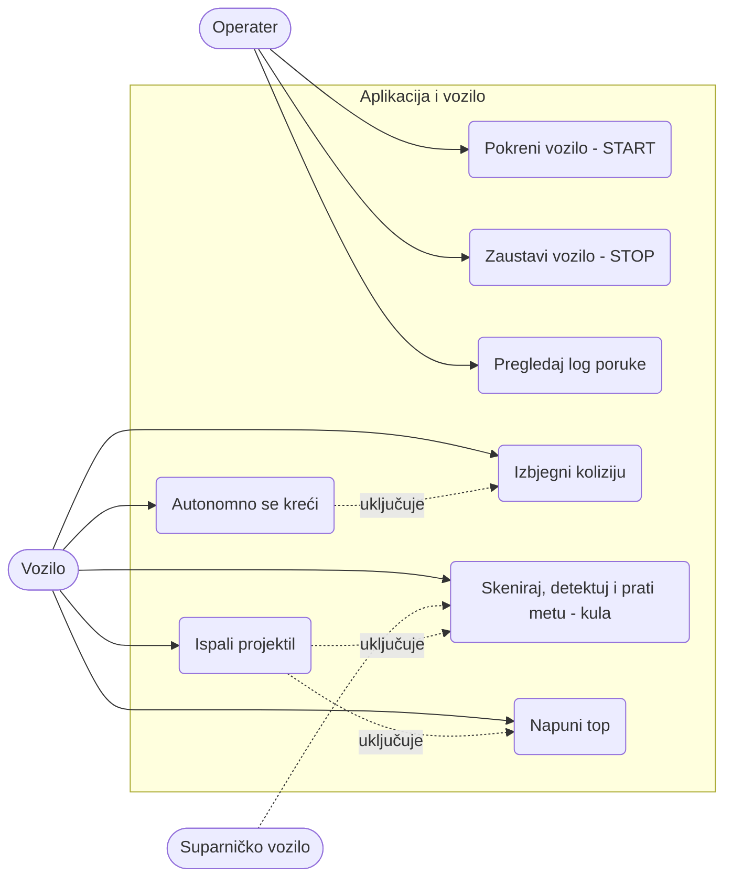

# Specifikacija zahtjeva (Requirements specification)

**Projekat:** Autonomna mobilna platforma sa integrisanim elektromagnetskim topom
**Verzija:** 0.3 (nacrt)
**Napomena:** Vrijednosti označene sa **TBD** potrebno je potvrditi sa predmetnim profesorom ili mjerenjem u toku razvoja.

---

## 1. Uvod

### 1.1 Svrha dokumenta
Dokument definiše funkcionalne i nefunkcionalne zahtjeve za autonomno vozilo zasnovano na JoyCar platformi, sa upravljačkom pločom koja ima integrisan elektromagnetski top (coilgun). Služi kao polazna tačka za projektovanje hardvera, firmvera i aplikacije.

### 1.2 Opis sistema
Sistem se sastoji od:
- **vozila** zasnovanog na JoyCar platformi, sa vlastitom upravljačkom pločom (PCB),
- **okretne kule** (servo) na kojoj se nalaze **elektromagnetski top, meta i ToF senzor koji skenira**, a koja se okreće nezavisno od šasije,
- **ToF senzora** u dvije uloge: jedan na kuli za detekciju i praćenje mete (skeniranje ispred vozila), a drugi nisko na šasiji za detekciju prepreka,
- **WiFi modula** za komunikaciju,
- **PC/mobilne aplikacije** za pokretanje, zaustavljanje i prijem log poruka.

Vozilo autonomno pozicionira sebe i gađa **pokretnu metu** koja se nalazi na suparničkom autonomnom vozilu istog tipa.

### 1.3 Definicije
| Pojam | Značenje |
|---|---|
| ToF | Time-of-Flight, senzor za mjerenje udaljenosti |
| Coilgun | Elektromagnetski top, zavojnica koja ubrzava feromagnetni projektil |
| Meta | Detekciona površina na kuli suparničkog vozila |
| Kula (turret) | Okretna platforma na kojoj su top, meta i ToF skener, a koja se okreće nezavisno od šasije |
| Skener | ToF senzor na kuli koji se okretanjem kule ponaša kao jednodimenzionalni lidar |
| Log poruka | Tekstualna poruka koju vozilo šalje aplikaciji |
| MCU | Mikrokontroler |

### 1.4 Učesnici
- **Korisnik/operater:** pokreće i zaustavlja vozilo i prati logove u aplikaciji.
- **Vozilo (sistem):** autonomno izvršava zadatak.
- **Suparničko vozilo:** pokretna meta i prepreka.

---

## 2. Funkcionalni zahtjevi

### 2.1 Upravljanje vozilom i kretanje
| ID | Zahtjev |
|---|---|
| FR-01 | Vozilo se kreće autonomno nakon komande START i zaustavlja se na komandu STOP. |
| FR-02 | Vozilo upravlja motorima JoyCar platforme (naprijed, nazad, skretanje, zaustavljanje). |

### 2.2 Detekcija prepreka i kontrola kolizije
| ID | Zahtjev |
|---|---|
| FR-03 | Vozilo ima dva ToF senzora: **nisko postavljen, fiksan senzor na šasiji** za detekciju prepreka i **senzor na kuli** (skener) za detekciju mete. |
| FR-04 | Kada nisko postavljeni ToF detektuje prepreku bližu od praga (**TBD** mm), vozilo se zaustavlja ili je zaobilazi. Ovo radi mašina stanja vozila i ne zavisi od rada kule. |

### 2.3 Detekcija i praćenje mete
| ID | Zahtjev |
|---|---|
| FR-05 | Kula skenira sektor od približno **120°** ispred vozila (**TBD**, korak i brzina skeniranja) i ToF skenerom detektuje pokretnu metu (suparničko vozilo), a nakon detekcije prati je užim sektorom. |
| FR-06 | Kula okreće top prema meti tako da su top i skener poravnati sa metom, bez okretanja šasije. |
| FR-12 | Kula se okreće servo motorom u opsegu od približno ±60° u odnosu na šasiju, nezavisno od kretanja vozila. Ploča upravlja položajem kule i zna njen trenutni ugao. |

### 2.4 Elektromagnetski top
| ID | Zahtjev |
|---|---|
| FR-07 | Ploča puni kondenzatore topa do radnog napona (**TBD** V) i mjeri njihov napon. |
| FR-08 | Top ispaljuje projektil kada je meta poravnata i kondenzator napunjen, uz minimalni razmak između ispaljivanja (**TBD** s). |

### 2.5 Komunikacija i aplikacija
| ID | Zahtjev |
|---|---|
| FR-09 | Vozilo se povezuje na WiFi mrežu i uspostavlja vezu sa aplikacijom. |
| FR-10 | Aplikacija ima komande **START** i **STOP**. |
| FR-11 | Vozilo šalje log poruke (stanje, udaljenost, ispaljivanje, greške), a aplikacija ih prikazuje u realnom vremenu. |

### 2.6 Stanja sistema
Sistem radi kao **dvije nezavisne mašine stanja**, koje rade istovremeno. Komanda START pokreće obje, a STOP ih vraća u stanje IDLE.

**Vozilo (šasija)**, koristi nisko postavljeni ToF:

`IDLE → DRIVE ⇄ AVOID`

- DRIVE: vozilo se kreće.
- AVOID: prepreka je bliža od praga, pa se vozilo zaustavlja ili je zaobilazi, a zatim se vraća u DRIVE.

**Kula (top)**, koristi ToF na kuli:

`IDLE → SEARCH → TRACK → FIRE → SEARCH`

- SEARCH: kula skenira sektor od 120° i traži metu.
- TRACK: meta je pronađena, kula je prati užim sektorom i poravnava top. Ako se meta izgubi, vraća se u SEARCH.
- FIRE: meta je poravnata i kondenzator napunjen, pa top ispaljuje projektil, a zatim se kula vraća u SEARCH.

Kondenzator se puni u pozadini, bez posebnog stanja, a minimalni razmak između ispaljivanja je uslov u zahtjevu FR-08.

---

## 3. Nefunkcionalni zahtjevi

### 3.1 Performanse
| ID | Zahtjev |
|---|---|
| NFR-01 | **Odziv:** reakcija na prepreku u roku od **TBD** ms, izvršenje STOP komande u roku od **TBD** ms, a jedno skeniranje sektora od 120° traje najviše **TBD** s. |
| NFR-02 | **Tačnost:** efektivni domet i procenat pogodaka određuju se mjerenjem (**TBD**). |

### 3.2 Sigurnost
| ID | Zahtjev |
|---|---|
| NFR-03 | **Sigurnost:** napon kondenzatora je ograničen (**TBD**, preporuka ≤ 50 V), uz automatsko pražnjenje i prekidač za isključenje. Ispaljivanje nije moguće bez potvrđenog punjenja. |

### 3.3 Pouzdanost i otpornost na greške
| ID | Zahtjev |
|---|---|
| NFR-04 | **Failsafe:** pri gubitku WiFi veze vozilo se zaustavlja, a top se razoružava. |
| NFR-05 | **Pouzdanost:** greške se bilježe i šalju kao log poruke, a firmver koristi watchdog timer. |

### 3.4 Hardverska ograničenja
| ID | Zahtjev |
|---|---|
| NFR-06 | **Hardver:** ploča se uklapa u JoyCar platformu (dimenzije, napon baterije, konektori), dvoslojna je i izrađena u KiCadu. Napajanje logike je odvojeno od motora, servoa i topa. Oba ToF senzora dijele I2C magistralu, uz različite adrese (npr. preko XSHUT pina). Kabl prema kuli je fleksibilan i podnosi zakretanje bez kliznog prstena. |

### 3.5 Softverska ograničenja i održivost
| ID | Zahtjev |
|---|---|
| NFR-07 | **Firmver:** modularan (WiFi, ToF, motori, top, mašina stanja), dokumentovan Doxygen komentarima. |
| NFR-08 | **Aplikacija:** radi na standardnom PC-u (**TBD**) i prikazuje samo START, STOP i prozor sa logovima. |
| NFR-09 | **Održivost:** projekat je u Git repozitoriju, a podešavanja (WiFi, IP, pragovi) u jednoj konfiguracionoj datoteci. |

### 3.6 Okruženje
| ID | Zahtjev |
|---|---|
| NFR-10 | **Okruženje:** rad u zatvorenom prostoru, na ravnoj podlozi, uz stabilnu WiFi mrežu. |

---

## 4. Format log poruka (prijedlog)

```
[vrijeme s] NIVO modul: poruka
[12.4s] INFO  STATE=TRACK dist=830mm
[13.1s] INFO  FIRE
[13.2s] ERROR CAP voltage low
```

Komande aplikacije: `START\n`, `STOP\n`. Poruke se završavaju znakom novog reda.

---

## 5. Use-case dijagram



---

## 6. Otvorena pitanja za profesora

1. Koji mikrokontroler i WiFi modul su dozvoljeni?
2. Šta tačno daje JoyCar platforma (motori, enkoderi, baterija, mjere)?
3. Šta je meta fizički (pločica koja detektuje pogodak, ili samo površina), njena veličina, materijal i visina, te vrsta projektila?
4. Ograničenje napona topa i budžeta?
5. Smije li se koristiti drugi senzor osim ToF-a?
6. Kakvo je takmičarsko polje (dimenzije, granice, zidovi)?
7. Šta se predaje i kako se ocjenjuje?
8. Smije li se za okretanje kule koristiti servo motor (ili je obavezan korak-motor)?

---

## 7. Praćenje (traceability)

| Funkcionalnost iz zadatka | Zahtjevi |
|---|---|
| Autonomno vozilo na JoyCar platformi | FR-01, FR-02 |
| Pozicioniranje i gađanje pokretne mete | FR-05, FR-06, FR-08, FR-12 |
| Elektromagnetski top (na okretnoj kuli) | FR-07, FR-08, FR-12 |
| Upravljanje vozilom, kontrola kolizije, ToF | FR-02, FR-03, FR-04 |
| WiFi: START/STOP i log poruke | FR-09, FR-10, FR-11 |
