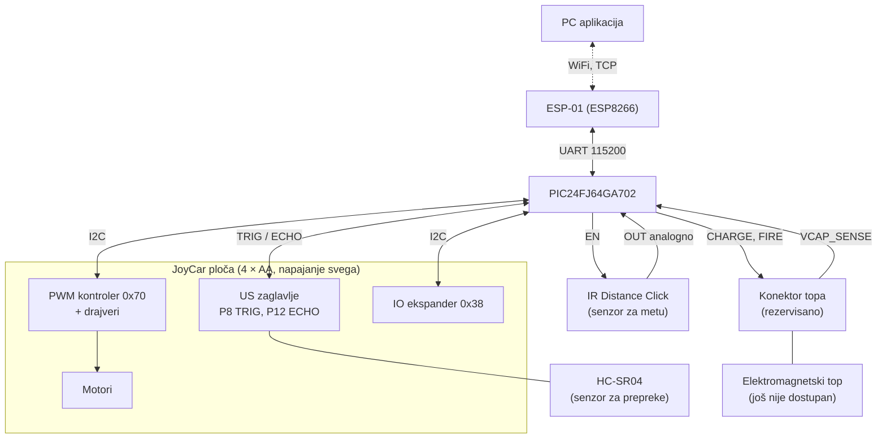
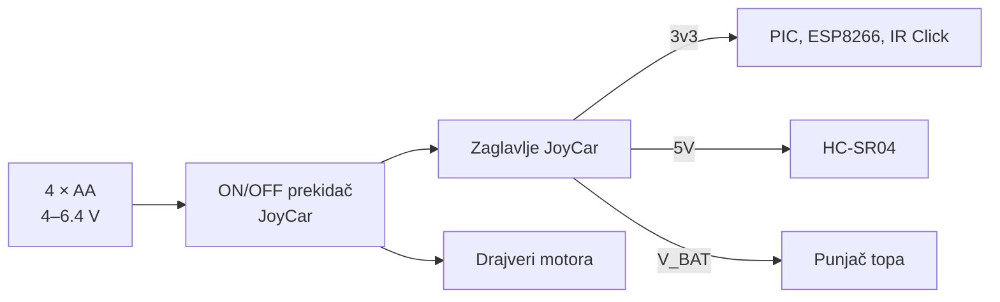

# Hardverska arhitektura

**Projekat:** Autonomna mobilna platforma sa integrisanim elektromagnetskim topom
**Verzija:** 0.1 (nacrt)
**Svrha:** Opis hardverskih blokova ploče, njihovih veza, napajanja i konektora. Tačne pinove, I2C adrese i protokol definiše dokument [interface.md](interface.md) i ovdje se ne ponavljaju.

Vrijednosti označene sa **TBD** treba potvrditi mjerenjem ili datasheetom.

---

## 1. Pregled

Naša ploča (PCB) **zamjenjuje micro:bit** na JoyCar platformi: ubacuje se u ivični utor JoyCar ploče, a JoyCar ploča već sadrži drajvere motora, senzore (linija, prepreke, brzina) i vezu sa baterijama. Ploča sadrži mikrokontroler, WiFi modul, priključke za senzore udaljenosti i rezervisani interfejs za elektromagnetski top.

Osnovna pravila:
- Cijeli sistem radi sa **jednog izvora**, 4 × 1.5 V AA baterija na JoyCar ploči.
- Ploča **nema vlastite regulatore**: napone 3v3, 5V i V_BAT uzima sa zaglavlja JoyCar ploče.
- Motorima se upravlja komandama preko **I2C** (PIC je master), a ne direktno.

---

## 2. Blok dijagram

---

## 3. Komponente

| Blok | Komponenta | Napon | Interfejs | Namjena |
|---|---|---|---|---|
| Mikrokontroler | PIC24FJ64GA702 (SOIC-28) | 3.3 V | I2C, UART, ADC, GPIO | Upravljanje, mašine stanja |
| WiFi | ESP8266 (ESP-01) | 3.3 V | UART, AT komande | Veza sa aplikacijom |
| Senzor za prepreke | HC-SR04 | 5 V | TRIG, ECHO (5 V signal) | Detekcija prepreka, niski senzor |
| Senzor za metu | IR Distance Click (Sharp GP2Y0A60SZ0F) | 3.3 V | analogni OUT, EN | Detekcija mete, 10–150 cm |
| Motori i drajveri | JoyCar ploča | V_BAT | I2C, 0x70 | Kretanje |
| Izvor | 4 × AA baterije | 4–6.4 V | zaglavlje | Napajanje svega |
| Top | Elektromagnetski top | **TBD** | CHARGE, FIRE, VCAP_SENSE | Gađanje (još nije dostupan) |

Detalji i razlozi izbora su u `interface.md`, odjeljak 1 i 3.1.

---

## 4. Napajanje

### 4.1 Struktura

Naponi se ne stvaraju na našoj ploči, pa opseg napona baterije (svježe baterije oko 6.4 V, prazne oko 4 V) nije naš problem, ali jeste problem **koliko struje zaglavlje može dati**.

### 4.2 Procjena potrošnje

Vrijednosti su okvirne, prema tipičnim podacima iz datasheeta, i treba ih provjeriti mjerenjem (**TBD**).

| Potrošač | Napon | Prosječno | Vršno | Napomena |
|---|---|---|---|---|
| PIC24FJ64GA702 | 3.3 V | oko 10 mA | oko 15 mA | Zavisi od takta |
| ESP8266 (ESP-01) | 3.3 V | oko 70 mA | do oko 300 mA | Šiljci pri slanju, potreban kondenzator 100–470 µF |
| IR Distance Click | 3.3 V | oko 30 mA | oko 50 mA | EN se može isključiti kad se ne mjeri |
| Status LED | 3.3 V | oko 5 mA | oko 5 mA | |
| **Zbir, 3.3 V** | | **oko 115 mA** | **oko 370 mA** | Provjeriti da li zaglavlje 3v3 to daje |
| HC-SR04 | 5 V | oko 15 mA | oko 15 mA | |
| Punjenje topa | V_BAT | **TBD** | **TBD** | Ograničiti struju, vidi 4.3 |

### 4.3 Rizici

- **Pad napona baterije.** Motori i punjenje topa povlače veliku struju, a baterija ima unutrašnji otpor, pa napon može pasti i resetovati PIC (brownout). Mjere: kondenzatori uz PIC i ESP8266, punjenje topa ograničenom strujom i samo kad vozilo stoji, zaustavljanje punjenja pri niskom naponu baterije (mjeri se na RA1, preko kontakta P2).
- **Kapacitet zaglavlja 3v3.** Ako JoyCar ne daje dovoljno struje za ESP8266, treba dodati lokalni kondenzator ili tražiti drugo rješenje (npr. posebni mali regulator, što treba najprije provjeriti sa timom).
- **Zajednička masa.** Sve komponente dijele GND sa JoyCar pločom, a motorni šum treba filtrirati kondenzatorima uz svaki pin napajanja.

---

## 5. Pinovi

Potpuna tabela pinova (PIC24FJ64GA702, SOIC-28) nalazi se u `interface.md`, odjeljak 3. Pregled grupa:

| Grupa | Pinovi | Veza |
|---|---|---|
| Programiranje | MCLR, RB0 (PGD1), RB1 (PGC1) | Programski konektor |
| I2C (JoyCar) | RB8 (SCL1), RB9 (SDA1) | PWM kontroler 0x70, IO ekspander 0x38 |
| UART (WiFi) | RB12 (RX), RB13 (TX) | ESP8266 |
| HC-SR04 | RB6 (TRIG), RB7 (ECHO, INT0) | JoyCar US zaglavlje |
| IR Distance Click | RB2 (OUT, AN4), RB3 (EN) | Senzor za metu |
| Baterija | RA1 (AN1) | JoyCar kontakt P2 |
| Top | RA0 (napon kondenzatora), RA3 (punjenje), RA4 (ispaljivanje), RB4 (rezerva) | Konektor topa |
| Korisnički | RB5 (dugme), RA2 (LED) | |
| Opciono | RB10, RB11 (drugi HC-SR04), RB14 (farovi), RB15 (zujalica) | |

---

## 6. Konektori i PCB

| Konektor | Namjena | Napomena |
|---|---|---|
| Ivični konektor (zlatni prsti) | Ulazi u micro:bit utor JoyCar ploče: P2, P8, P12, P19, P20, 3V, GND, opciono P0 i P16 | 1.6 mm ploča, ENIG površina, raspored kopirati sa stvarnog micro:bita |
| Napajanje sa zaglavlja | 3v3, 5V, V_BAT, GND | Posebnim konektorom ili žicama, jer nisu na ivičnom konektoru |
| Programski konektor | MCLR, PGD1, PGC1, 3.3 V, GND | Za programer |
| ESP-01 | UART, 3.3 V, EN | Utičnica 2 × 4 |
| IR Distance Click | OUT, EN, 3.3 V, GND | Utičnica za click modul ili žice |
| Konektor topa | VBAT, GND, CHARGE, FIRE, VCAP_SENSE, rezerva | Raspored u `interface.md`, odjeljak 5 |

PCB:
- Dvoslojna ploča, izrada u KiCadu 8, fabrikacija u Kini.
- Oblik i dimenzije moraju odgovarati JoyCar platformi i micro:bit utoru (**TBD**, mjerenje).
- Test tačke na I2C, UART, 3.3 V, 5 V i V_BAT.

---

## 7. Top: pravila interfejsa

Top još nije dostupan, pa se unaprijed predviđa samo interfejs:
- **CHARGE** (izlaz): omogućava punjenje kondenzatora.
- **FIRE** (izlaz): okida ispaljivanje, preko drivera i samo uz potvrđeno punjenje.
- **VCAP_SENSE** (ulaz, ADC): napon kondenzatora preko razdjelnika sa zaštitnom Zener diodom.
- Bleeder otpornik za automatsko pražnjenje, prekidač i osigurač na napajanju topa.
- Ograničenje napona kondenzatora (**TBD**, preporuka ≤ 50 V).
- Jumperi na linijama topa, da se top može odvojiti od ploče.

---

## 8. Mjerenja prije slanja na fabrikaciju

| # | Šta izmjeriti | Zašto |
|---|---|---|
| 1 | Napon i dostupna struja 3v3 i 5V zaglavlja pod opterećenjem (WiFi, motori) | Da li zaglavlje izdržava ESP8266 |
| 2 | Pad napona baterije pod opterećenjem motora | Prag za zaštitu i kondenzatori |
| 3 | SDA i SCL: logički nivo i pull-up otpornici bez micro:bita | Da li dodati pull-up |
| 4 | 3V kontakt micro:bita: smjer (izlaz ili ulaz) | Da li ploču napajati kroz ivični konektor |
| 5 | Geometrija ivičnog konektora (razmak, širina i dužina prstiju, debljina) | Footprint |
| 6 | Opseg napona na P2 (jumper BAT) | Skaliranje ADC-a |
| 7 | Smjerovi motora i raspored PWM kanala | Provjera tabele u `interface.md` |

---

## 9. Otvorene stavke

| # | Stavka | Ko saznaje |
|---|---|---|
| 1 | Potvrda MCU-a i IR modula | Profesor |
| 2 | Rezultati mjerenja iz odjeljka 8 | HW tim |
| 3 | Napon, struja i konektor topa | Kad se top dobije |
| 4 | Da li je potreban dodatni kondenzator ili regulator za ESP8266 | HW tim, nakon mjerenja 1 |
| 5 | Prag napona baterije za zaustavljanje | HW + SW tim |
