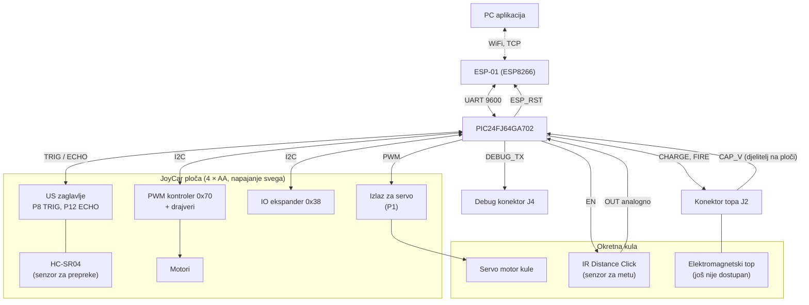
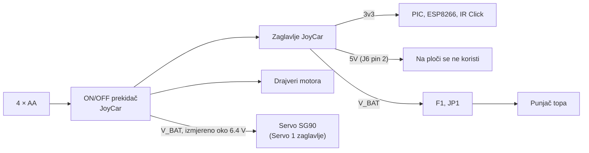

# Hardverska arhitektura
 
**Projekat:** Autonomna mobilna platforma sa integrisanim elektromagnetskim topom
**Verzija:** 0.7 (nacrt)
**Svrha:** Opis hardverskih blokova ploče, njihovih veza, napajanja i konektora. Tačne pinove, I2C adrese i protokol definiše dokument `hwsw-interface.md`, pa se ovdje ne ponavljaju.
 
**Šema:** KiCad 10, folder `hardware/Vihor` (opis u odjeljku 9), PDF u `docs/Vihor.pdf`.
 
Vrijednosti označene sa **TBD** treba potvrditi mjerenjem ili datasheetom.
 
---
 
## 1. Pregled
 
Naša ploča (PCB) **zamjenjuje micro:bit** na JoyCar platformi: ubacuje se u ivični utor JoyCar ploče. JoyCar ploča već ima drajvere motora, senzore i vezu sa baterijama. Naša ploča ima mikrokontroler, WiFi modul, priključke za senzore, servo motor kule i interfejs za elektromagnetski top.
 
Osnovna pravila:
- Cijeli sistem radi sa **jednog izvora**, 4 × AA baterije na JoyCar ploči.
- Ploča **nema vlastite regulatore**: napone 3v3, 5V i V_BAT uzima sa zaglavlja JoyCar ploče.
- Motorima se upravlja komandama preko **I2C** (PIC je master).
- Top, senzor za metu i servo su na **okretnoj kuli**, a senzor za prepreke je fiksiran na šasiji.
---
 
## 2. Blok dijagram
 

 
---
 
## 3. Komponente
 
| Blok | Komponenta | Napon | Interfejs | Namjena |
|---|---|---|---|---|
| Mikrokontroler | PIC24FJ64GA702 (SOIC-28) | 3.3 V | I2C, UART, ADC, GPIO | Upravljanje, mašine stanja |
| WiFi | ESP8266 (ESP-01) | 3.3 V | UART, AT komande | Veza sa aplikacijom |
| Senzor za prepreke | HC-SR04 | 5 V | TRIG, ECHO (5 V signal) | Detekcija prepreka, na šasiji |
| Senzor za metu | IR Distance Click (Sharp GP2Y0A60SZ0F) | 3.3 V | analogni OUT, EN | Detekcija mete, 10–150 cm, na kuli |
| Kula | Servo motor SG90 | oko 5 V (**TBD**) | PWM 50 Hz | Okretanje kule |
| Motori i drajveri | JoyCar ploča | V_BAT | I2C, 0x70 | Kretanje |
| Izvor | 4 × AA baterije | oko 4–6.4 V | zaglavlje | Napajanje svega |
| Top | Elektromagnetski top | **TBD** | CHARGE, FIRE, VCAP_SENSE | Gađanje, na kuli (još nije dostupan) |
 
Razlozi izbora su u `hwsw-interface.md`, odjeljak 1 i 3.1.
 
---
 
## 4. Napajanje
 
### 4.1 Struktura
 

 
Naponi se ne stvaraju na našoj ploči: dolaze konektorom J6 (1 +3.3V, 2 +5V, 3 VBAT, 4 GND). HC-SR04 napaja JoyCar direktno preko US zaglavlja. Pitanje je **koliko struje zaglavlje JoyCar ploče može dati**.
 
### 4.2 Potrošači
 
Struje nisu izmjerene (**TBD**), a treba ih provjeriti na prototipu:
- PIC24FJ64GA702 (3.3 V)
- ESP8266 (3.3 V), ima najveću potrošnju i skokove struje pri slanju
- IR Distance Click (3.3 V)
- HC-SR04 (5 V)
- Servo motor SG90: Servo 1 zaglavlje JoyCar ploče daje V_BAT (izmjereno oko 6.4 V); granica napona SG90 je **TBD**
- Punjenje topa (V_BAT)
### 4.3 Rizici
 
- **Pad napona baterije.** Motori, servo i punjenje topa povlače veliku struju, pa napon može pasti i resetovati PIC. Zato punjenje topa ide ograničenom strujom i samo dok vozilo stoji, a napon baterije se mjeri na RA1.
- **Kapacitet zaglavlja 3v3.** Ako JoyCar ne daje dovoljno struje za ESP8266, treba dodati kondenzator ili drugo rješenje.
- **Zajednička masa.** Sve komponente dijele GND sa JoyCar pločom, a uz napajanje svakog čipa ide kondenzator.
---
 
## 5. Pinovi
 
Potpuna tabela pinova je u `hwsw-interface.md`, odjeljak 3. Pregled grupa:
 
| Grupa | Pinovi | Veza |
|---|---|---|
| Programiranje | MCLR, RB0 (PGD1), RB1 (PGC1) | Programski konektor J3 |
| I2C (JoyCar) | RB8 (SCL1), RB9 (SDA1) | PWM kontroler 0x70, IO ekspander 0x38 |
| UART (WiFi) | RB12 (RX), RB13 (TX) | ESP8266 |
| HC-SR04 | RB6 (TRIG), RB7 (ECHO, INT0) | JoyCar US zaglavlje |
| IR Distance Click | RB2 (OUT, AN4), RB3 (EN) | Senzor za metu |
| Servo kule | RB14 (PWM) | JoyCar izlaz za servo (P1) |
| Baterija | RA1 (AN1) | JoyCar kontakt P2 |
| Top | RA0 (napon kondenzatora), RA3 (punjenje), RA4 (ispaljivanje), RB4 (rezerva) | Konektor topa |
| Korisnički | RB5 (dugme), RA2 (LED) | |
| WiFi reset | RB10 (ESP_RST) | RST modula ESP-01 |
| Debug | RB11 (DEBUG_TX) | Debug konektor J4 |
| Zujalica | RB15 (BUZZER) | JoyCar kontakt P16 (upotreba opciona) |
 
Pin za servo (RB14) je usklađen sa `software.md` i upisan u `hwsw-interface.md` (v0.16). Slobodnih pinova nema; rezerve su RB4 (rezervisan za top) i RB15 (zujalica, upotreba opciona).
 
---
 
## 6. Konektori i PCB
 
| Oznaka | Namjena | Pinovi |
|---|---|---|
| J5 | Ivični konektor (zlatni prsti), ulazi u micro:bit utor JoyCar ploče | 1 GND, 2 SDA, 3 SCL, 4 EDGE_3V, 5 BUZZER, 6 VBAT_SENSE, 7 ECHO, 8 TRIG, 9 SERVO_PWM |
| J6 | Napajanje sa JoyCar zaglavlja | 1 +3.3V, 2 +5V, 3 VBAT, 4 GND |
| J3 | Programski konektor | 1 MCLR, 2 +3.3V, 3 GND, 4 PGD1, 5 PGC1 |
| J4 | Debug konektor (UART, samo slanje) | 1 DEBUG_TX, 2 GND |
| U1 | ESP-01 | Utičnica 2 × 4 |
| J1 | IR Distance Click (senzor za metu) | 1 +3.3V, 2 GND, 3 IR_OUT, 4 IR_EN |
| J2 | Top | 1 VBAT (preko F1 i JP1), 2 GND, 3 TOP_CHARGE, 4 TOP_FIRE, 5 CAP_V, 6 TOP_RESERVE |
| JP1 | Kratkospojnik za odvajanje napajanja topa | 2 pina |
 
Raspored zlatnih prstiju (J5) je sa micro:bita, a tačne mjere su **TBD**.
 
PCB:
- Dvoslojna ploča, KiCad 10, fabrikacija u Kini.
- Ploča 1.6 mm, zlatni prsti sa ENIG površinom.
- Oblik i dimenzije odgovaraju JoyCar platformi i micro:bit utoru (**TBD**, mjerenje).
- Pasivni dijelovi su u kućištu 0805 (lako se lemi ručno).
- Neugrađena mjesta (DNP) za pull-up otpornike na SDA i SCL (R14, R16), djelitelj na VBAT_SENSE (R12) i premosnicu za 3V (R17), da se greške mogu popraviti bez nove ploče.
- Test tačke: TP1 (VBAT), TP2 (UART_TX), TP3 (UART_RX), TP4 (SDA), TP5 (SCL) i TP6 (+3.3V).
- Top, senzor za metu i servo su na kuli, pa kablovi do njih moraju biti savitljivi.
---
 
## 7. Top: interfejs
 
Top još nije dostupan, pa se unaprijed predviđa samo interfejs:
- **CHARGE** (izlaz): uključuje punjenje kondenzatora.
- **FIRE** (izlaz): okida ispaljivanje, samo uz potvrđeno punjenje.
- **VCAP_SENSE** (ulaz, ADC): napon kondenzatora preko razdjelnika. Na šemi su to djelitelj R5/R7 i zener dioda D1 (štiti ulaz RA0), vrijednosti **TBD**. Sa topa dolazi signal CAP_V (J2, pin 5).
- Pull-down otpornici R3 (TOP_CHARGE) i R4 (TOP_FIRE), 10k: drže linije na nuli dok ih PIC ne preuzme (reset, programiranje).
- Na napajanju topa su osigurač F1 (vrijednost **TBD**) i kratkospojnik JP1. Bleeder otpornik i prekidač nisu na šemi (**TBD**).
- Ograničenje napona kondenzatora (**TBD**).
- Kratkospojnikom JP1 se napajanje topa odvaja od ploče.
- Konektor topa je J2 (raspored u odjeljku 6).
---
 
## 8. Provjere na prototipu
 
| # | Šta provjeriti | Zašto |
|---|---|---|
| 1 | Napon i struja 3v3 i 5V zaglavlja pod opterećenjem (WiFi, motori, servo) | Da li zaglavlje izdržava sve potrošače |
| 2 | Pad napona baterije pod opterećenjem | Prag za zaštitu |
| 3 | Geometrija ivičnog konektora (razmak, širina i dužina prstiju) | Footprint |
| 4 | Smjerovi motora i raspored PWM kanala | Provjera tabele u `hwsw-interface.md` |
| 5 | Napajanje i struja servo motora kule | Da li ga zaglavlje može napajati |
| 6 | Mjere i smjer prstiju micro:bita (širina, dužina, razmak od ivice, GND desno gledano sa prednje strane) | Footprint J5 |
 
---
 
## 9. Električna šema (KiCad)
 
Šema je u folderu `hardware/Vihor`, a PDF svih listova je u `docs/Vihor.pdf` (*File → Plot*, ponoviti nakon svake izmjene šeme).
 
### 9.1 Organizacija šeme
 
| List | Fajl | Sadržaj |
|---|---|---|
| Korijenski list | `Vihor.kicad_sch` | Naslovni list (naziv projekta, revizija, datum) sa dva hijerarhijska lista: „Blok šema“ i „Moduli“ |
| Blok šema | `blok_sema.kicad_sch` | Blok dijagram ploče: četiri bloka i signali između njih |
| Moduli | `moduli.kicad_sch` | Cijela električna šema, podijeljena okvirima na četiri bloka (9.2) |
 
Svi dijelovi su na jednom listu („Moduli“). Blokovi su grafički okviri, a veze između njih su labele: ista labela na dva mjesta znači istu vezu. Otvorena pitanja (**TBD**) upisana su u dnu svakog bloka.
 
**Nazivi veza:**
- napajanje: `+3.3V`, `+5V`, `VBAT`, `GND`
- programiranje: `MCLR`, `PGD1`, `PGC1`
- komunikacija: `UART_TX` (izlaz PIC-a, ide na RXD ESP-a), `UART_RX` (ulaz PIC-a, dolazi sa TXD ESP-a), `ESP_RST`, `DEBUG_TX`, `SDA`, `SCL`
- senzori: `TRIG`, `ECHO`, `IR_OUT`, `IR_EN`
- kula i top: `SERVO_PWM`, `TOP_CHARGE`, `TOP_FIRE`, `TOP_RESERVE`, `CAP_V` (sa topa), `VCAP_SENSE` (na RA0, iza djelitelja)
- ostalo: `VBAT_SENSE`, `BUZZER`, `LED`, `BTN`, `EDGE_3V`
 
### 9.2 Blokovi
 
Za svaki blok je opisano šta radi, kako je riješen i zašto, te šta je još otvoreno. Spisak svih dijelova sa vrijednostima i footprintima je u `components.md`, odjeljak 3, a pinovi PIC-a u `hwsw-interface.md`, odjeljak 3.
 
#### MCU i napajanje
 
**Uloga:** mikrokontroler IC1 (PIC24FJ64GA702) upravlja cijelim vozilom. Ovaj blok ima i ulaz napajanja ploče, konektore za programiranje i debug, dugme, statusnu LED i test tačke.
 
**Kako je riješeno:**
- **Napajanje** dolazi sa zaglavlja JoyCar ploče preko konektora J6 (1 +3.3V, 2 +5V, 3 VBAT, 4 GND). Ploča nema vlastitih regulatora, pa sve zavisi od JoyCar 3,3 V izlaza. +5V je doveden, ali ga na ploči ne koristi nijedan dio (rezerva).
- **Kondenzatori uz PIC:** C4 (VDD, pin 13) i C6 (AVDD, pin 28), 100 nF, prigušuju kratke smetnje na napajanju i stoje što bliže pinovima. C5 (10 µF) na pinu VCAP (20) je obavezan kondenzator za unutrašnji regulator jezgre PIC-a; bez njega PIC ne radi.
- **Reset:** R10 (10k) drži MCLR na „1“, pa PIC normalno radi. Programator pri programiranju spušta MCLR i tako preuzima PIC.
- **Programski konektor J3** (1 MCLR, 2 +3.3V, 3 GND, 4 PGD1, 5 PGC1) služi za programiranje PIC-a na ploči (ICSP), preko pinova RB0 i RB1.
- **Dugme SW1** je spojeno na BTN (RB5) i GND, sa pull-up otpornikom R15 (10k): nepritisnuto je „1“, pritisnuto „0“. Na ploči nema kola za debounce, pa se odskakivanje kontakata rješava u firmveru.
- **Statusna LED D2** je na RA2, preko otpornika R9 (1k), koji ograničava struju na nekoliko mA.
- **Debug konektor J4** (1 DEBUG_TX, 2 GND): PIC preko RB11 (UART2) šalje poruke na računar kroz USB-UART adapter. Tako se firmver može pratiti i bez WiFi-ja, npr. dok veza sa ESP-om još ne radi.
- **Test tačke** TP1 (VBAT), TP2 (UART_TX), TP3 (UART_RX), TP4 (SDA), TP5 (SCL) i TP6 (+3.3V) služe za mjerenje na prototipu multimetrom, osciloskopom ili logičkim analizatorom.
 
**Otvoreno:** koliko struje daje JoyCar 3,3 V izlaz pod opterećenjem (**TBD**, mjerenje).
 
#### Ivični konektor
 
**Uloga:** preko konektora J5 naša ploča ulazi u micro:bit utor JoyCar ploče, umjesto micro:bita. Kroz njega idu signali prema JoyCar ploči: I2C prema motorima i senzorima, ultrazvučni senzor, servo kule, zujalica i napon baterije.
 
**Kako je riješeno:**
- **J5** ima 9 zlatnih prstiju, samo za kontakte koje koristimo: 1 GND, 2 SDA (P20), 3 SCL (P19), 4 EDGE_3V (3V), 5 BUZZER (P16), 6 VBAT_SENSE (P2), 7 ECHO (P12), 8 TRIG (P8), 9 SERVO_PWM (P1). Napajanje ploče ne ide kroz utor, nego preko J6.
- **R13 (1k)** je u seriji na liniji ECHO. HC-SR04 daje ECHO od 5 V; RB7 je 5 V tolerantan, a otpornik dodatno ograničava struju u pin.
- **R11 (0 Ω) i R12 (DNP)** su mjesto za djelitelj napona baterije (VBAT_SENSE). JoyCar već ima djelitelj na P2 (izmjereno oko 2,6 V pri 6,45 V, ispod 3,3 V), pa R11 služi kao obična veza, a R12 se ne ugrađuje. Ako bi napon ikad prelazio 3,3 V, na mjesto R11 se zalemi otpornik i ugradi R12, bez nove ploče.
- **R14 i R16 (DNP)** su mjesta za I2C pull-up otpornike na SDA i SCL. JoyCar ploča ih već ima (izmjereno), pa se ne ugrađuju.
- **R17 (0 Ω, DNP)** je premosnica između kontakta 3V u utoru (EDGE_3V) i +3.3V naše ploče. Nije provjereno da li JoyCar kroz taj kontakt daje napon ili ga očekuje od micro:bita. Dok se to ne provjeri, kontakt ostaje odvojen, da dva izvora od 3,3 V ne bi radila paralelno.
 
**Otvoreno:**
- veza ECHO preko P12: mjerenje pokazuje da P12 u utoru nije spojen sa pinom E na US zaglavlju (`hwsw-interface.md`, 4.5). Treba riješiti prije naručivanja ploče (**TBD**);
- smjer napajanja na kontaktu 3V (odluka o R17);
- tačne mjere prstiju i sa koje strane ploče su (**TBD**).
 
#### WiFi modul
 
**Uloga:** veza vozila sa aplikacijom na računaru. ESP-01 (U1) prima AT komande od PIC-a preko UART1 (UART_TX, UART_RX, 9600 baud) i komunicira sa računarom preko WiFi-ja.
 
**Kako je riješeno:**
- ESP-01 se utakne u **utičnicu 2 × 4**, pa se može izvaditi i pripremiti van ploče (upis AT firmvera, podešavanje brzine). Na ploči nema konektora za programiranje ESP-a.
- Pinovi **EN, IO0 i IO2** su pull-up otpornicima R1, R6 i R8 (10k) držani na „1“, jer modul samo tako startuje normalno. Sa IO0 na „0“ pri paljenju ulazi u režim za programiranje.
- **RST** ima pull-up R2 (10k), a spojen je i na PIC (ESP_RST, RB10). Ako modul prestane odgovarati, PIC ga može sam resetovati, bez gašenja vozila.
- Pri slanju ESP povlači kratke strujne šiljke do oko 300 mA. Kondenzatori **C1 (100 µF), C2 (10 µF) i C3 (100 nF)** stoje uz napajanje modula, da napon 3,3 V ne propadne i ne resetuje modul ili PIC.
 
**Otvoreno:** vrsta kondenzatora C1, polarizovani ili nepolarizovani (**TBD**, zavisi od toga koji su kondenzatori dostupni).
 
#### Senzori i top
 
**Uloga:** priključci za senzor za metu (IR Distance Click) i elektromagnetski top, koji su na okretnoj kuli, te zaštita i mjerenje za top.
 
**Kako je riješeno:**
- **J1** je konektor za IR Distance Click: 1 +3.3V, 2 GND, 3 IR_OUT (RB2, analogni ulaz), 4 IR_EN (RB3). Modul se napaja sa 3,3 V, da njegov izlaz ne pređe 3,3 V, koliko podnosi ADC PIC-a.
- **J2** je konektor topa: 1 VBAT, 2 GND, 3 TOP_CHARGE (RA3), 4 TOP_FIRE (RA4), 5 CAP_V, 6 TOP_RESERVE (RB4).
- **Napajanje topa** ide iz VBAT preko osigurača **F1** i kratkospojnika **JP1**. F1 štiti baterije i staze na ploči ako se u topu napravi kratak spoj. JP1 omogućava da se top fizički odvoji od napajanja: bez kapice top nema napajanje, npr. dok se ispituje ostatak vozila.
- **R3 i R4 (10k)** su pull-down otpornici na TOP_CHARGE i TOP_FIRE. Dok se PIC pali, resetuje ili programira, njegovi pinovi nisu ni na „0“ ni na „1“. Otpornici tada drže obje linije na „0“, pa top ne počne puniti niti opali slučajno.
- **R5 i R7** su djelitelj napona: smanjuju napon kondenzatora topa (CAP_V, viši od 3,3 V) na VCAP_SENSE, koji PIC mjeri na RA0 (ADC). Odnos se bira tako da pri najvećem naponu kondenzatora VCAP_SENSE ne pređe 3,3 V.
- **D1 (zener dioda)** štiti RA0: ako napon na VCAP_SENSE ipak poraste preko njenog napona (npr. zbog kvara ili pogrešnog djelitelja), dioda provodi i ograničava ga.
 
**Otvoreno:**
- napon i struja topa (kad se top dobije), a od njih zavise vrijednosti F1, R5, R7 i D1 (**TBD**);
- ako je napon kondenzatora visok, kroz J2 i R5 ide taj napon, pa konektor, otpornik i razmaci na ploči moraju biti predviđeni za njega (**TBD**);
- bleeder otpornik za pražnjenje kondenzatora i prekidač nisu na šemi (**TBD**).
 
### 9.3 Neugrađeni dijelovi (DNP)
 
| Oznaka | Vrijednost | Namjena |
|---|---|---|
| R12 | 10k | Donji dio djelitelja na VBAT_SENSE (uz R11 0 Ω) |
| R14, R16 | 10k | Pull-up na SDA i SCL (JoyCar ih već ima, ostaju neugrađeni) |
| R17 | 0 Ω | Premosnica između EDGE_3V i +3.3V (dok se ne provjeri smjer napajanja) |
 
Spisak svih dijelova sa vrijednostima i footprintima je u `components.md`, odjeljak 3.
 
**Stanje:** footprinti su dodijeljeni svim dijelovima (ivični konektor J5: `vihor:MicroBit_EdgeFingers_9`). Privremeni su footprinti za C1 (čeka se koji su kondenzatori dostupni) i D1 (zener dioda: napon i tačan model još nisu izabrani, pa je footprint SOD-123 privremen). ERC (16.11.2026): 0 grešaka, 1 upozorenje: četiri žice spojene u jednoj tački (veza je ispravna, upozorenje se odnosi samo na preglednost crteža); isključene su provjere SPICE modela (šema se ne simulira) i slaganja footprinta sa filterima simbola.
