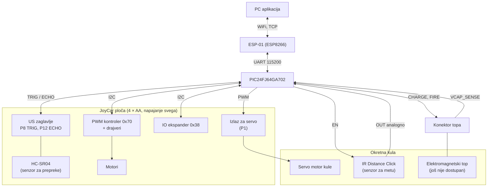
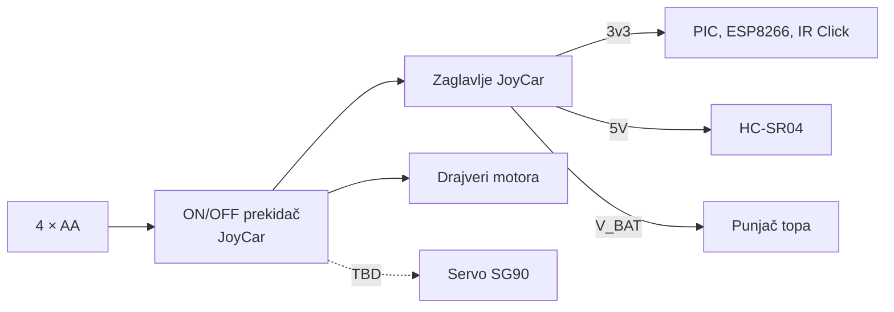

# Hardverska arhitektura
 
**Projekat:** Autonomna mobilna platforma sa integrisanim elektromagnetskim topom
**Verzija:** 0.5 (nacrt)
**Svrha:** Opis hardverskih blokova ploče, njihovih veza, napajanja i konektora. Tačne pinove, I2C adrese i protokol definiše dokument `hwsw-interface.md`, pa se ovdje ne ponavljaju.
 
**Šema:** KiCad 10, folder `hardware/Vihor` (opis u odjeljku 9).
 
Vrijednosti označene sa **TBD** treba potvrditi mjerenjem ili datasheetom.
 
---
 
## 1. Pregled
 
Naša ploča (PCB) **zamjenjuje micro:bit** na JoyCar platformi: ubacuje se u ivični utor JoyCar ploče. JoyCar ploča već ima drajvere motora, senzore i vezu sa baterijama. Naša ploča ima mikrokontroler, WiFi modul, priključke za senzore, servo motor kule i interfejs za elektromagnetski top.
 
Osnovna pravila:
- Cijeli sistem radi sa **jednog izvora**, 4 × AA baterije na JoyCar ploči.
- Ploča **nema vlastite regulatore**: napone 3v3, 5V i V_BAT uzima sa zaglavlja JoyCar ploče.
- Motorima se upravlja komandama preko **I2C** (PIC je master).
- Top, senzor za metu i servo su na **okretnoj kuli**, a senzor za prepreke je fiksiran na šasiji.
---
 
## 2. Blok dijagram
 

 
---
 
## 3. Komponente
 
| Blok | Komponenta | Napon | Interfejs | Namjena |
|---|---|---|---|---|
| Mikrokontroler | PIC24FJ64GA702 (SOIC-28) | 3.3 V | I2C, UART, ADC, GPIO | Upravljanje, mašine stanja |
| WiFi | ESP8266 (ESP-01) | 3.3 V | UART, AT komande | Veza sa aplikacijom |
| Senzor za prepreke | HC-SR04 | 5 V | TRIG, ECHO (5 V signal) | Detekcija prepreka, na šasiji |
| Senzor za metu | IR Distance Click (Sharp GP2Y0A60SZ0F) | 3.3 V | analogni OUT, EN | Detekcija mete, 10–150 cm, na kuli |
| Kula | Servo motor SG90 | oko 5 V (**TBD**) | PWM 50 Hz | Okretanje kule |
| Motori i drajveri | JoyCar ploča | V_BAT | I2C, 0x70 | Kretanje |
| Izvor | 4 × AA baterije | oko 4–6.4 V | zaglavlje | Napajanje svega |
| Top | Elektromagnetski top | **TBD** | CHARGE, FIRE, VCAP_SENSE | Gađanje, na kuli (još nije dostupan) |
 
Razlozi izbora su u `hwsw-interface.md`, odjeljak 1 i 3.1.
 
---
 
## 4. Napajanje
 
### 4.1 Struktura
 

 
Naponi se ne stvaraju na našoj ploči. Pitanje je **koliko struje zaglavlje JoyCar ploče može dati**.
 
### 4.2 Potrošači
 
Struje nisu izmjerene (**TBD**), a treba ih provjeriti na prototipu:
- PIC24FJ64GA702 (3.3 V)
- ESP8266 (3.3 V), ima najveću potrošnju i skokove struje pri slanju
- IR Distance Click (3.3 V)
- HC-SR04 (5 V)
- Servo motor SG90 (napajanje oko 5 V, a odakle ga napajati je **TBD**; V_BAT sa svježim baterijama može preći 6 V)
- Punjenje topa (V_BAT)
### 4.3 Rizici
 
- **Pad napona baterije.** Motori, servo i punjenje topa povlače veliku struju, pa napon može pasti i resetovati PIC. Zato punjenje topa ide ograničenom strujom i samo dok vozilo stoji, a napon baterije se mjeri na RA1.
- **Kapacitet zaglavlja 3v3.** Ako JoyCar ne daje dovoljno struje za ESP8266, treba dodati kondenzator ili drugo rješenje.
- **Zajednička masa.** Sve komponente dijele GND sa JoyCar pločom, a uz napajanje svakog čipa ide kondenzator.
---
 
## 5. Pinovi
 
Potpuna tabela pinova je u `hwsw-interface.md`, odjeljak 3. Pregled grupa:
 
| Grupa | Pinovi | Veza |
|---|---|---|
| Programiranje | MCLR, RB0 (PGD1), RB1 (PGC1) | Programski konektor |
| I2C (JoyCar) | RB8 (SCL1), RB9 (SDA1) | PWM kontroler 0x70, IO ekspander 0x38 |
| UART (WiFi) | RB12 (RX), RB13 (TX) | ESP8266 |
| HC-SR04 | RB6 (TRIG), RB7 (ECHO, INT0) | JoyCar US zaglavlje |
| IR Distance Click | RB2 (OUT, AN4), RB3 (EN) | Senzor za metu |
| Servo kule | RB14 (PWM) | JoyCar izlaz za servo (P1) |
| Baterija | RA1 (AN1) | JoyCar kontakt P2 |
| Top | RA0 (napon kondenzatora), RA3 (punjenje), RA4 (ispaljivanje), RB4 (rezerva) | Konektor topa |
| Korisnički | RB5 (dugme), RA2 (LED) | |
| Rezerva | RB10, RB11 (slobodni), RB15 (zujalica, opciono) | |
 
Pin za servo (RB14) je usklađen sa `software.md` i upisan u `hwsw-interface.md` (v0.10).
 
---
 
## 6. Konektori i PCB
 
| Oznaka | Namjena | Pinovi |
|---|---|---|
| J3 | Ivični konektor (zlatni prsti), ulazi u micro:bit utor JoyCar ploče | 1 GND, 2 SDA, 3 SCL, 4 EDGE_3V, 5 BUZZER, 6 VBAT_SENSE, 7 ECHO, 8 TRIG, 9 SERVO_PWM |
| J2 | Napajanje sa JoyCar zaglavlja | 1 +3.3V, 2 +5V, 3 VBAT, 4 GND |
| J1 | Programski konektor | 1 MCLR, 2 +3.3V, 3 GND, 4 PGD1, 5 PGC1 |
| U1 | ESP-01 | Utičnica 2 × 4 |
| J4 | IR Distance Click (senzor za metu) | 1 +3.3V, 2 GND, 3 IR_OUT, 4 IR_EN |
| J5 | Top | 1 VBAT, 2 GND, 3 TOP_CHARGE, 4 TOP_FIRE, 5 CAP_V, 6 TOP_RESERVE |
 
Raspored zlatnih prstiju (J3) je sa micro:bita, a tačne mjere su **TBD**.
 
PCB:
- Dvoslojna ploča, KiCad 10, fabrikacija u Kini.
- Ploča 1.6 mm, zlatni prsti sa ENIG površinom.
- Oblik i dimenzije odgovaraju JoyCar platformi i micro:bit utoru (**TBD**, mjerenje).
- Pasivni dijelovi su u kućištu 0805 (lako se lemi ručno).
- Neugrađena mjesta (DNP) za pull-up otpornike na SDA i SCL, djelitelj na VBAT_SENSE i premosnicu za 3V, da se greške mogu popraviti bez nove ploče.
- Test tačke na I2C, UART, 3.3 V, 5 V i V_BAT (**TBD**, dodaju se na ploči).
- Top, senzor za metu i servo su na kuli, pa kablovi do njih moraju biti savitljivi.
---
 
## 7. Top: interfejs
 
Top još nije dostupan, pa se unaprijed predviđa samo interfejs:
- **CHARGE** (izlaz): uključuje punjenje kondenzatora.
- **FIRE** (izlaz): okida ispaljivanje, samo uz potvrđeno punjenje.
- **VCAP_SENSE** (ulaz, ADC): napon kondenzatora preko razdjelnika. Na šemi su to R13, R14 i zener dioda D1 (štiti ulaz RA0), vrijednosti **TBD**.
- Bleeder otpornik za pražnjenje, prekidač i osigurač na napajanju topa.
- Ograničenje napona kondenzatora (**TBD**).
- Jumperi na linijama topa, da se top može odvojiti od ploče.
- Konektor topa je J5 (raspored u odjeljku 6).
---
 
## 8. Provjere na prototipu
 
| # | Šta provjeriti | Zašto |
|---|---|---|
| 1 | Napon i struja 3v3 i 5V zaglavlja pod opterećenjem (WiFi, motori, servo) | Da li zaglavlje izdržava sve potrošače |
| 2 | Pad napona baterije pod opterećenjem | Prag za zaštitu |
| 3 | SDA i SCL: logički nivo i pull-up otpornici | Da li dodati pull-up |
| 4 | Geometrija ivičnog konektora (razmak, širina i dužina prstiju) | Footprint |
| 5 | Napon na P2 (jumper BAT) | Skaliranje ADC-a |
| 6 | Smjerovi motora i raspored PWM kanala | Provjera tabele u `hwsw-interface.md` |
| 7 | Napajanje i struja servo motora kule | Da li ga zaglavlje može napajati |
| 8 | Mjere i smjer prstiju micro:bita (širina, dužina, razmak od ivice, GND desno gledano sa prednje strane) | Footprint J3 |
| 9 | Da li JoyCar ploča već ima pull-up na SDA i SCL | R6 i R7 se ugrađuju samo ako nema |
 
---
 
## 9. Električna šema (KiCad)
 
Šema je u folderu `hardware/Vihor`: jedan korijenski list i četiri lista.
 
| List | Fajl | Sadržaj |
|---|---|---|
| MCU i napajanje | `mcu.kicad_sch` | PIC24FJ64GA702, kondenzatori, reset, programski konektor J1, dugme, LED, ulaz napajanja J2 |
| Ivični konektor | `edge.kicad_sch` | J3, pull-up za I2C, serijski otpornik na ECHO, mjesto za djelitelj na VBAT_SENSE |
| WiFi | `wifi.kicad_sch` | ESP-01, UART, pull-up otpornici, kondenzatori |
| Senzori i top | `sensors_top.kicad_sch` | J4 (IR Distance Click), J5 (top), mjerenje napona kondenzatora |
 
Veze između listova su **global labele**: ista labela na dva mjesta znači istu vezu. Zato na korijenskom listu nema žica.
 
**Nazivi veza:**
- napajanje: `+3.3V`, `+5V`, `VBAT`, `GND`
- programiranje: `MCLR`, `PGD1`, `PGC1`
- komunikacija: `UART_TX` (izlaz PIC-a, ide na RXD ESP-a), `UART_RX` (ulaz PIC-a, dolazi sa TXD ESP-a), `SDA`, `SCL`
- senzori: `TRIG`, `ECHO`, `IR_OUT`, `IR_EN`
- kula i top: `SERVO_PWM`, `TOP_CHARGE`, `TOP_FIRE`, `TOP_RESERVE`, `VCAP_SENSE`
- ostalo: `VBAT_SENSE`, `BUZZER`, `LED`, `BTN`, `EDGE_3V`
**Neugrađeni dijelovi (DNP):**
 
| Oznaka | Vrijednost | Namjena |
|---|---|---|
| R5 | 10k | Donji dio djelitelja na VBAT_SENSE (uz R3 0R) |
| R6, R7 | 10k | Pull-up na SDA i SCL (samo ako ih JoyCar nema) |
| R8 | 0R | Premosnica između EDGE_3V i +3.3V (dok se ne provjeri smjer napajanja) |
 
**Stanje:** ERC bez grešaka i upozorenja. Footprinti su dodijeljeni svim dijelovima osim J3 (u izradi), a C4 i D1 su privremeni.
