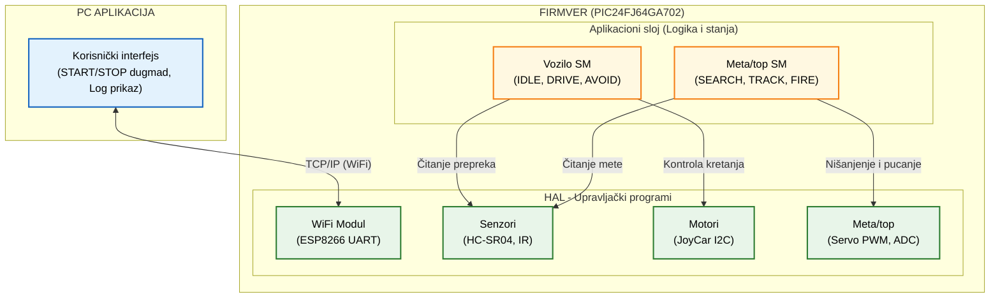

# Softverska arhitekura

**Projekat:** Autonomna mobilna platforma sa integrisanim elektromagnetskim topom

**Verzija:** 0.1

## 1. Uvod

### 1.1 Svrha dokumenta

Ovaj dokument definiše softversku arhitekturu sistema, uključujući strukturu firmvera, mašine stanja, komunikacioni protokol i arhitekturu aplikacije. Firmver je modularan i sastoji se od nezavisnih modula koji komuniciraju preko jasno definisanih interfejsa.

### 1.2 Ciljevi arhitekure

- Modularnost:  Firmver je podijeljen na nezavisne module sa jasno definisanim API-jem.
- Determinizam i real-time odziv: Mašine stanja i upravljanje motorima/senzorima moraju reagovati u definisanim vremenskim okvirima (NFR-01).
- Robusnost (Failsafe): Sistem mora ući u sigurno stanje (IDLE) pri gubitku komunikacije ili niskom naponu baterije.

### 1.3 Ograničenja

- MCU: PIC24FJ64GA702 (ograničena memorija i procesorska snaga)
- Dvije nezavisne mašine stanja izvršavaju se konkurento

## 2. Blok dijagram softverske arhitekture

Dijagram prikazuje slojevitu arhitekturu firmvera. Aplikacioni sloj (Logika) sadrži mašine stanja koje donose odluke, dok HAL (Hardware Abstraction Layer) sadrži upravljačke programe koji komuniciraju sa fizičkim hardverom. 

## 3. Struktura firmvera i moduli

Firmver je organizovan po principu apstrakcije hardvera (HAL). Gornji sloj (mašine stanja) ne zna detalje o hardveru, već samo poziva funkcije modula.

### 3.1 Tabela modula i API interfejsa

| Modul | Odgovornost | Hardverski interfejs | Ključne funkcije (API) |
|-------|-------------|---------------------|------------------------|
| **System** | Inicijalizacija sistema, glavna petlja, watchdog | - | `system_init()`, `system_loop()`, `system_reset()` |
| **Motors** | Kontrola motora preko JoyCar I2C magistrale | I2C1 (Adresa: 0x70 PWM kontroler) | `motors_init()`, `motors_drive(speed_L, speed_R)`, `motors_stop()`, `motors_brake()` |
| **ObstacleSensor** | Mjerenje udaljenosti prepreka | HC-SR04: TRIG (RB6), ECHO (RB7, INT0) | `obstacle_init()`, `obstacle_get_distance_mm()`, `obstacle_is_triggered(threshold_mm)` |
| **TargetSensor** | Detekcija i praćenje mete | IR Distance Click: OUT (RB2/AN4), EN (RB3) | `target_init()`, `target_get_distance_mm()`, `target_enable()`, `target_disable()` |
| **Battery** | Mjerenje napona baterije, detekcija niskog napona | ADC (RA1/AN1) | `battery_init()`, `battery_get_voltage()`, `battery_is_low()` |
| **Turret** | Kontrola servo motora kule | Servo PWM (RB14 - predlog, treba potvrditi) | `turret_init()`, `turret_set_angle(deg)`, `turret_get_angle()`, `turret_scan_step(direction)` |
| **Coilgun** | Punjenje kondenzatora i okidanje topa | CHARGE (RA3), FIRE (RA4), VCAP_SENSE (RA0/AN0) | `coilgun_init()`, `coilgun_start_charge()`, `coilgun_fire()`, `coilgun_get_voltage()`, `coilgun_is_ready()` |
| **WiFi** | Komunikacija sa ESP8266, slanje/prijem podataka | UART1 (RB12 RX, RB13 TX, 115200 baud) | `wifi_init()`, `wifi_connect(ssid, pass)`, `wifi_send_log(msg)`, `wifi_get_command()`, `wifi_is_connected()` |
| **Logger** | Formatiranje log poruka prema protokolu | - (koristi WiFi modul) | `log_info(module, msg)`, `log_warn(module, msg)`, `log_error(module, msg)` |

### 4.2 Mašina stanja: KULA (Top/Meta)

