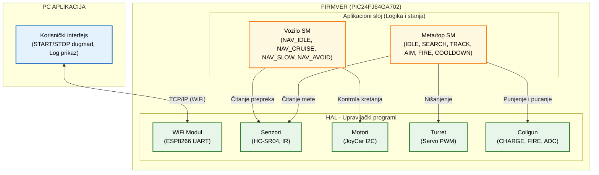
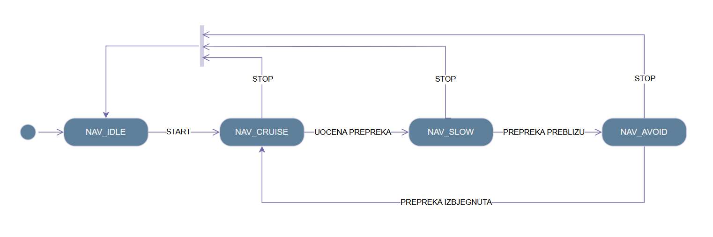
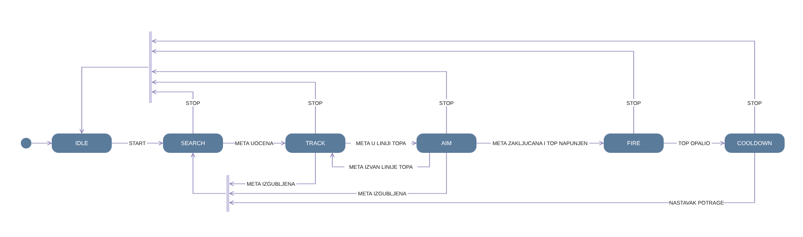
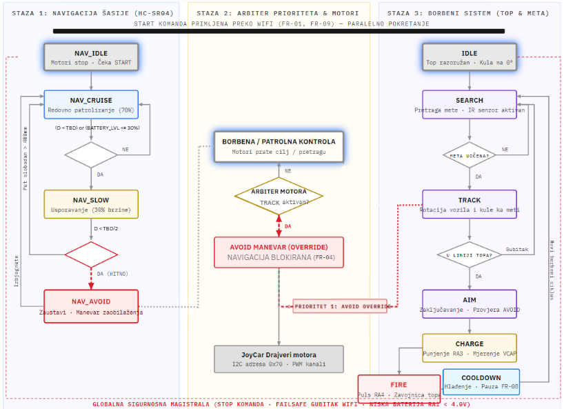

# Softverska arhitektura

**Projekat:** Autonomna mobilna platforma sa integrisanim elektromagnetskim topom

**Verzija:** 0.3

## 1. Uvod

### 1.1 Svrha dokumenta

Ovaj dokument definiše softversku arhitekturu sistema, uključujući strukturu firmvera, mašine stanja, komunikacioni protokol i arhitekturu aplikacije. Firmver je modularan i sastoji se od nezavisnih modula koji komuniciraju preko jasno definisanih interfejsa.

### 1.2 Ciljevi arhitekture

- Modularnost:  Firmver je podijeljen na nezavisne module sa jasno definisanim API-jem.
- Determinizam i real-time odziv: Mašine stanja i upravljanje motorima/senzorima moraju reagovati u definisanim vremenskim okvirima (NFR-01).
- Robusnost (Failsafe): Sistem mora ući u sigurno stanje (IDLE) pri gubitku komunikacije ili niskom naponu baterije.

### 1.3 Ograničenja

- MCU: PIC24FJ64GA702 (ograničena memorija i procesorska snaga)
- Dvije nezavisne mašine stanja izvršavaju se konkurentno
  
## 2. Blok dijagram softverske arhitekture

Dijagram prikazuje slojevitu arhitekturu firmvera. Aplikacioni sloj (Logika) sadrži mašine stanja koje donose odluke, dok HAL (Hardware Abstraction Layer) sadrži upravljačke programe koji komuniciraju sa fizičkim hardverom. 

## 3. Struktura firmvera i moduli

Firmver je organizovan po principu apstrakcije hardvera (HAL). Gornji sloj (mašine stanja) ne zna detalje o hardveru, već samo poziva funkcije modula.

### 3.1 Tabela modula i API interfejsa

| Modul | Odgovornost | Hardverski interfejs | Ključne funkcije (API) |
|-------|-------------|---------------------|------------------------|
| **System** | Inicijalizacija sistema, glavna petlja, watchdog | - | `system_init()`, `system_loop()`, `system_reset()` |
| **Motors** | Kontrola motora preko JoyCar I2C magistrale | I2C1 (Adresa: 0x70 PWM kontroler) | `motors_init()`, `motors_drive(speed_L, speed_R)`, `motors_stop()`, `motors_brake()` |
| **ObstacleSensor** | Mjerenje udaljenosti prepreka | HC-SR04: TRIG (RB6), ECHO (RB7, INT0) | `obstacle_init()`, `obstacle_get_distance_mm()`, `obstacle_is_triggered(threshold_mm)` |
| **TargetSensor** | Detekcija i praćenje mete | IR Distance Click: OUT (RB2/AN4), EN (RB3) | `target_init()`, `target_get_distance_mm()`, `target_enable()`, `target_disable()` |
| **Battery** | Mjerenje napona baterije, proračun procenta i detekcija upozorenja/kritičnog stanja | ADC (RA1/AN1) | `battery_init()`, `battery_get_voltage()`, `battery_get_percentage()`, `battery_is_warning()`, `battery_is_low()` |
| **Turret** | Kontrola servo motora kule | PWM: servo (RB14) | `turret_init()`, `turret_set_angle(deg)`, `turret_get_angle()`, `turret_scan_step(direction)` |
| **Coilgun** | Punjenje kondenzatora, mjerenje napona i okidanje topa | CHARGE (RA3), FIRE (RA4), VCAP_SENSE (RA0/AN0) | `coilgun_init()`, `coilgun_start_charge()`, `coilgun_stop_charge()`, `coilgun_fire()`, `coilgun_get_voltage()`, `coilgun_is_ready()` |
| **WiFi** | Komunikacija sa ESP8266, slanje logova, parsiranje komandi, reset ESP modula. | UART1 (9600 baud), GPIO: RB10 (ESP_RST), RB11 (DEBUG_TX) | `wifi_init()`, `wifi_connect(ssid, pass)`, `wifi_send_log(msg)`, `wifi_get_command()`, `wifi_is_connected()` |
| **Logger** | Formatiranje log poruka prema protokolu | - (koristi WiFi modul) | `log_info(module, msg)`, `log_warn(module, msg)`, `log_error(module, msg)` |

## 4. Dinamički aspekti (Mašine stanja)

### 4.1 Mašina stanja: Navigacija vozila

### Opis navigacione mašine stanja (Navigacija vozila)

Navigaciona mašina stanja funkcioniše potpuno nezavisno od borbene logike i upravlja kretanjem, brzinom i izbjegavanjem prepreka pomoću senzora:

* **NAV_IDLE (Mirovanje):** Početno stanje u kojem su motori isključeni, a platforma miruje i čeka globalnu `START` komandu;
* **NAV_CRUISE (Krstarenje):** Redovna vožnja i patroliranje terenom nakon pokretanja sistema;
* **NAV_SLOW (Usporavanje):** Reakcija na uočenu prepreku na srednjoj distanci (`UOCENA PREPREKA`) ili je nivo baterije ispod 30%, gdje sistem smanjuje brzinu kretanja radi lakše kontrole;
* **NAV_AVOID (Izbjegavanje):** Kritično stanje manevra kada je prepreka preblizu (`PREPREKA PREBLIZU`), gdje vozilo vrši korekciju smjera sve dok se put ponovo ne oslobodi (`PREPREKA IZBJEGNUTA` $\rightarrow$ povrat u `NAV_CRUISE`);
* **STOP prekid:** Zajednička sigurnosna magistrala koja iz bilo kog stanja navigacije trenutno zaustavlja motore i vraća sistem u `NAV_IDLE`;

### 4.2 Mašina stanja: Top/Meta

### Opis borbene mašine stanja (Top/Meta)
Borbena mašina stanja (Top/Meta) upravlja cjelokupnom logikom lociranja, nišanjenja, punjenja i opaljenja projektila iz elektromagnetnog topa na platformi. Logika je dizajnirana tako da omogući automatski ciklus sa visokim stepenom sigurnosti i otpornosti na gubitak mete:

* **IDLE (Mirovanje):** Početno stanje sistema u kojem vozilo miruje i čeka `START` komandu sa PC aplikacije;
* **SEARCH (Pretraga mete):** Faza u kojoj vozilo patrolira terenom i koristi senzore za lociranje protivničke mete;
* **TRACK (Praćenje mete):** Meta je uočena (`META UOCENA`). Vozilo staje, kula prati metu i počinje punjenje kondenzatora (CHARGE na RA3, mjerenje napona preko VCAP_SENSE na RA0); u slučaju gubitka mete (`META IZGUBLJENA`), sistem se automatski vraća u `SEARCH`;
* **AIM (Nišanjenje):** Fino poravnavanje kada je meta u liniji topa (`META U LINIJI TOPA`), punjenje kondenzatora se nastavlja. Ako meta izađe iz linije topa, ali je i dalje vidljiva, sistem se vraća u `TRACK`, a ako se meta izgubi, vraća se u `SEARCH`;
* **FIRE (Opaljenje):** Slanje okidačkog impulsa i pražnjenje energije kroz kaleme ka meti kada je meta zaključana (`META ZAKLJUCANA`), kondenzator napunjen (`TOP NAPUNJEN`) i protekao minimalni razmak između ispaljivanja (FR-08);
* **COOLDOWN (Hlađenje):** Sigurnosna faza hlađenja nakon pucanja (`TOP OPALIO`), nakon čega se ciklus zatvara i nastavlja potraga (`NASTAVAK POTRAGE`);
* **STOP prekid:** Globalna sigurnosna linija koja iz bilo kog trenutnog borbenog stanja trenutno ruši procese i vraća sistem u sigurno `IDLE` stanje;

#### 4.3 Dijagram aktivnosti softverske arhitekture i arbitraže

##### Opis dijagrama aktivnosti
Dijagram aktivnosti prikazuje dinamički tok izvršavanja firmvera na mikrokontroleru PIC24FJ64GA702, obuhvatajući inicijalizaciju, paralelni rad dviju nezavisnih mašina stanja, arbitražu upravljanja motorima i bezbjednosne prekide:

1. **Inicijalizacija i pokretanje:**
   * Sistem započinje u neaktivnom stanju (`NAV_IDLE` za navigaciju i `IDLE` za borbenu logiku);
   * Prijemom komande `START` sa PC aplikacije putem WiFi konekcije (ESP8266 UART1 interfejs pri 9600 baud), pokreću se paralelne niti upravljanja za navigaciju i borbenu logiku;

2. **Paralelni rad mašina stanja (Konkurentni tokovi):**
   * **Navigaciona mašina stanja (Šasija):** Vozilo prelazi u `NAV_CRUISE` (krstarenje). Senzor HC-SR04 na šasiji kontinuirano prati prepreke. Detekcijom prepreke na srednjoj distanci ili kada je nivo baterije ispod 30% (BATTERY_LVL < 30%), vozilo prelazi u `NAV_SLOW` (usporavanje), a pri kritičnoj blizini u `NAV_AVOID` (manevrisanje/izbjegavanje). Po izbjegavanju prepreke, vozilo se vraća u `NAV_CRUISE`;
   * **Borbena mašina stanja (Top/Meta):** Ulazi u `SEARCH` (pretraga mete). Kada IR Distance Click senzor na kuli detektuje cilj, prelazi u `TRACK`: vozilo staje, kula prati metu i paralelno počinje punjenje kondenzatora (preko RA3, uz mjerenje napona preko VCAP_SENSE na RA0). Punjenje traje i u stanju `AIM`, samo dok motori stoje. Kada je meta u liniji topa, sistem prelazi u `AIM`, a kada je meta zaključana, kondenzator napunjen i ispunjen minimalni razmak između ispaljivanja (FR-08), prelazi u `FIRE`. Zatim slijede `COOLDOWN` i nova pretraga. Ako meta izađe iz linije topa, ali je i dalje vidljiva, sistem se iz `AIM` vraća u `TRACK`, a ako se izgubi, iz `TRACK` ili `AIM` vraća se u `SEARCH`;

3. **Arbitraža upravljanja motorima (Prioritizacija):**
   * Patrolna kontrola (motori prate cilj/pretragu) šalje zahtjeve za kretanje ka bloku ARBITER MOTORA;
   * Arbiter provjerava da li je navigaciona mašina u stanju `NAV_AVOID`. Ako jeste, izvršava se manevar izbjegavanja prepreke (PRIORITET 1, FR-04), a komande za kretanje iz borbene logike se privremeno ignorišu radi sprečavanja kolizije;
   * Kada nema prepreke, komande prolaze na JoyCar Drajvere motora (I2C adresa 0x70, PWM kanali) na JoyCar ploči;

4. **Bezbjednosni prekidi (Failsafe & STOP):**
   * Prijemom komande `STOP`, gubitkom WiFi mrežne veze ili detekcijom niskog napona baterije (`battery_is_low()`), sigurnosni modul bez odlaganja zaustavlja motore, razoružava kolo topa i vraća obje mašine stanja u početno mirovanje (`NAV_IDLE` i `IDLE`);

## 5. Komunikacioni protokoli

### 5.1 Fizički i mrežni sloj

Komunikacija između PC aplikacije i vozila odvija se preko WiFi mreže koristeći TCP/IP protokol.

1. **WiFi:** ESP8266 u Station modu, spaja se na mrežu preko AT komandi.
2. **UART:** PIC ↔ ESP8266, 9600 baud, 8N1 (koristi AT komande za inicijalizaciju).
3. **TCP:** Vozilo je TCP klijent, PC Aplikacija je TCP server. 

### 5.2 Komande (Aplikacija → Vozilo)

Poruke su tekstualne, ASCII kodirane, i završavaju znakom novog reda (`\n`).

| Komanda | Značenje | Očekivani odgovor vozila |
| :--- | :--- | :--- |
| `START\n` | Pokreće obje mašine stanja. | `[0.0s] INFO SYS: START received` |
| `STOP\n` | Zaustavlja vozilo, razoružava top, vraća u IDLE. | `[0.0s] INFO SYS: STOP received` |

### 5.3 Log poruke (Vozilo → Aplikacija)

Format log poruka je strogo definisan radi lakšeg parsiranja na strani aplikacije.

**Format:** `[vrijeme_s] NIVO modul: poruka\n`

**Definicija polja:**
1. **vrijeme_s:** Float, sekunde od zadnje START komande (npr. `12.4s`).
2. **NIVO:** `INFO`, `WARN`, `ERROR`.
   - `INFO`: Normalne informacije o stanju sistema (promjena stanja, detekcija mete, ispaljivanje).
   - `WARN`: Upozorenja koja zahtijevaju pažnju ali ne zaustavljaju sistem (npr. niska baterija < 30%).
   - `ERROR`: Kritične greške koje aktiviraju failsafe (npr. nivo baterije 5% ili niže, napon ispod 4.0 V, gubitak WiFi veze, greška u komunikaciji sa senzorom).
4. **modul:** Opciono, skraćenica modula (npr. `SYS`, `NAV`, `MOT`,`BAT`, `TUR`).
5. **poruka:** Slobodan tekst ili `KLJUČ=vrijednost` parovi.
