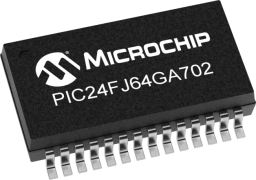
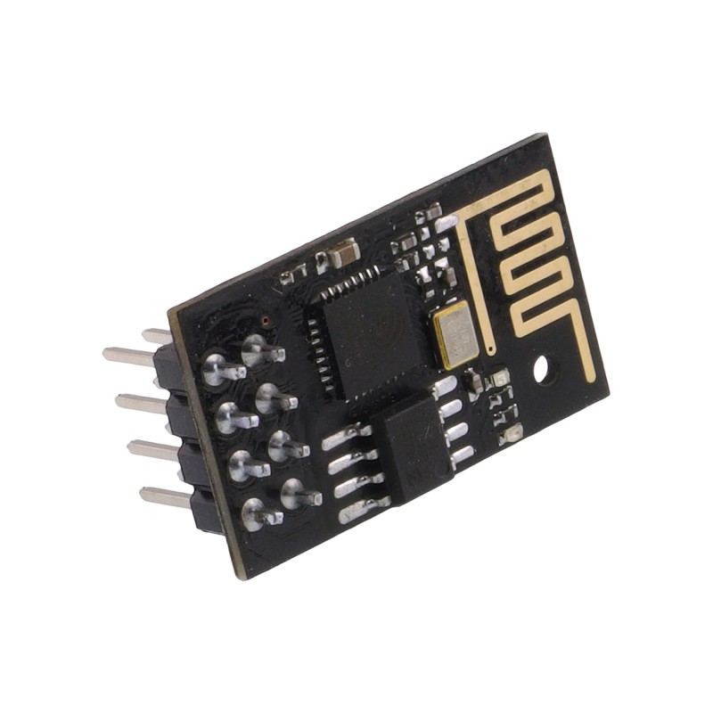
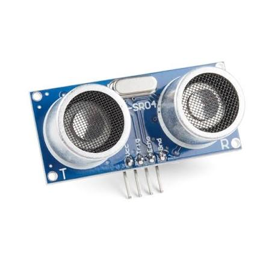
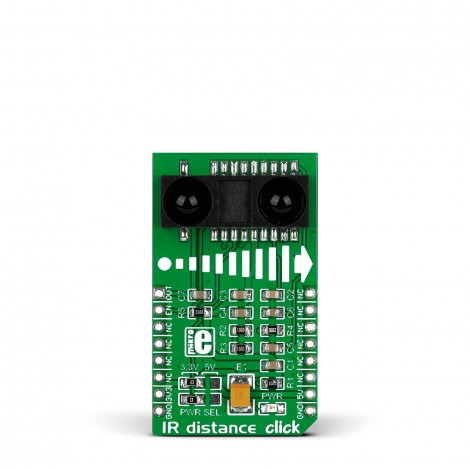
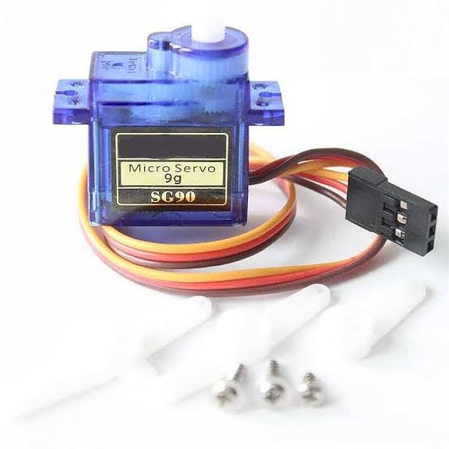

# Spisak komponenti

**Projekat:** Autonomna mobilna platforma sa integrisanim elektromagnetskim topom
**Verzija:** 0.4 (nacrt)
**Svrha:** Pregled svih komponenti sistema sa slikom, namjenom i osnovnim podacima. Detalji o pinovima su u `hwsw-interface.md`, a o napajanju i blokovima u `hardware.md`.

**Slike:** fotografije se stavljaju u folder `docs/images/` pod nazivom iz oznake slike uz komponentu. Dok slika ne postoji, prikazuje se prazan okvir.

Vrijednosti označene sa **TBD** treba potvrditi.

---

## 1. Glavne komponente

### 1.1 Mikrokontroler: PIC24FJ64GA702

| Svojstvo | Vrijednost |
|---|---|
| Namjena | Upravljanje cijelim sistemom, mašine stanja |
| Kućište | SOIC-28 |
| Napon | 3.3 V |
| Interfejsi | I2C, UART, ADC, GPIO |
| Status | Potvrđeno |
| Dokumentacija | [Datasheet (porodica PIC24FJ256GA705)](https://ww1.microchip.com/downloads/aemDocuments/documents/MCU16/ProductDocuments/DataSheets/PIC24FJ256GA705-Family-Data-Sheet-DS30010118E.pdf) |

### 1.2 WiFi modul: ESP-01 (ESP8266)

| Svojstvo | Vrijednost |
|---|---|
| Namjena | Veza sa PC aplikacijom (WiFi, TCP) |
| Napon | 3.3 V |
| Interfejs | UART, 115200 baud, AT komande |
| Napomena | Veća struja pri slanju (**TBD**) |
| Status | Potvrđeno |
| Dokumentacija | [Datasheet](https://www.alldatasheet.com/datasheet-pdf/view/1179098/ETC2/ESP-01.html) |

### 1.3 Senzor za prepreke: HC-SR04

| Svojstvo | Vrijednost |
|---|---|
| Namjena | Detekcija prepreka (niski senzor na šasiji) |
| Napon | 5 V |
| Interfejs | TRIG (ulaz), ECHO (izlaz, 5 V signal) |
| Priključak | JoyCar US zaglavlje (P8 TRIG, P12 ECHO) |
| Status | Potvrđeno |
| Dokumentacija | [Datasheet](https://cdn.sparkfun.com/datasheets/Sensors/Proximity/HCSR04.pdf) |

### 1.4 Senzor za metu: IR Distance Click

| Svojstvo | Vrijednost |
|---|---|
| Proizvođač | MikroElektronika |
| Senzor | Sharp GP2Y0A60SZ0F |
| Namjena | Detekcija mete, opseg 10–150 cm, na kuli |
| Napon | 3.3 V (jumperi PWR SEL na 3V3) |
| Interfejs | Analogni izlaz OUT, pin EN |
| Status | Potvrditi sa profesorom |
| Dokumentacija | [Datasheet](https://download.mikroe.com/documents/datasheets/GP2Y0A60SZxF.pdf) |

### 1.5 Okretna kula (servo motor SG90)

| Svojstvo | Vrijednost |
|---|---|
| Namjena | Okretanje kule sa topom, metom i senzorom za metu |
| Tip | SG90 (modelarski servo) |
| Interfejs | PWM 50 Hz, JoyCar izlaz za servo (P1) |
| Opseg okretanja | Oko 180° (provjeriti), potreban opseg **TBD** |
| Napajanje | Oko 5 V (provjeriti datasheet), izvor **TBD** |

### 1.6 JoyCar platforma

| Svojstvo | Vrijednost |
|---|---|
| Proizvođač | Joy-IT |
| Sadržaj | Šasija, motori, ploča sa drajverima motora, senzori (linija, prepreke, brzina), držač baterija |
| I2C uređaji | PWM kontroler 0x70, IO ekspander 0x38 |
| Napajanje | 4 × AA, ulaz 4.5–9 V, prekidač ON/OFF |
| Zaglavlje | 3v3, 5V, V_BAT, V_LED, GND, EOUT7 |
| Namjena | Pogon i izvor napajanja za cijeli sistem |

### 1.7 Baterije: 4 × AA

| Svojstvo | Vrijednost |
|---|---|
| Namjena | Jedini izvor napajanja za cijeli sistem |
| Napon | Oko 4–6.4 V (4 × 1.5 V) |
| Napomena | Pad napona pod opterećenjem, vidi `hardware.md`, odjeljak 4.3 |

### 1.8 Elektromagnetski top (coilgun)

| Svojstvo | Vrijednost |
|---|---|
| Namjena | Ispaljivanje projektila, na kuli |
| Signali | CHARGE, FIRE, VCAP_SENSE (vidi `hwsw-interface.md`, odjeljak 5) |
| Status | **Još nije isporučen**, rezervisan konektor i pinovi |

---

## 2. Naša ploča (PCB)

| Dio | Opis | Napomena |
|---|---|---|
| Ivični konektor (zlatni prsti) | Zamjenjuje micro:bit u utoru JoyCar ploče | 1.6 mm, ENIG, raspored sa stvarnog micro:bita |
| Priključak napajanja | 3v3, 5V, V_BAT, GND sa JoyCar zaglavlja | Konektor ili žice |
| Programski konektor | MCLR, PGD1, PGC1 | Za programer |
| Konektor topa | VBAT, GND, CHARGE, FIRE, VCAP_SENSE | Rezervisano |

---

## 3. Pomoćne komponente

Vrijednosti su prijedlog i potvrđuju se pri izradi šeme.

| Komponenta | Namjena | Količina | Napomena |
|---|---|---|---|
| Kondenzatori 100 nF | Blokiranje napajanja uz svaki pin napajanja | **TBD** | |
| Kondenzator uz ESP8266 | Skokovi struje pri slanju | 1 | **TBD** vrijednost |
| Kondenzator VCAP | Jezgro PIC-a | 1 | Prema datasheetu |
| Pull-up otpornici | I2C (SDA, SCL), MCLR, EN modula ESP8266 | **TBD** | Provjeriti postoje li na JoyCar ploči |
| Serijski otpornik | Zaštita ulaza ECHO | 1 | **TBD** vrijednost |
| Dugme | START/STOP | 1 | |
| LED | Status | 1 | |
| Razdjelnik napona i Zener dioda | Mjerenje napona kondenzatora topa | **TBD** | |
| Programer za PIC | Programiranje mikrokontrolera | 1 | **TBD** model |
| Utičnica 2 × 4 | Za ESP-01 | 1 | |

---

## 4. Pregled napajanja i interfejsa

| Komponenta | Napon | Interfejs | Pinovi PIC-a |
|---|---|---|---|
| ESP-01 | 3.3 V | UART | RB12, RB13 |
| HC-SR04 | 5 V | TRIG, ECHO | RB6, RB7 |
| IR Distance Click | 3.3 V | OUT, EN | RB2, RB3 |
| Servo kule (SG90) | oko 5 V (**TBD**) | PWM | RB14 |
| JoyCar (motori, senzori) | V_BAT | I2C | RB8, RB9 |
| Top | **TBD** | CHARGE, FIRE, VCAP_SENSE | RA3, RA4, RA0 |
