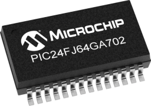
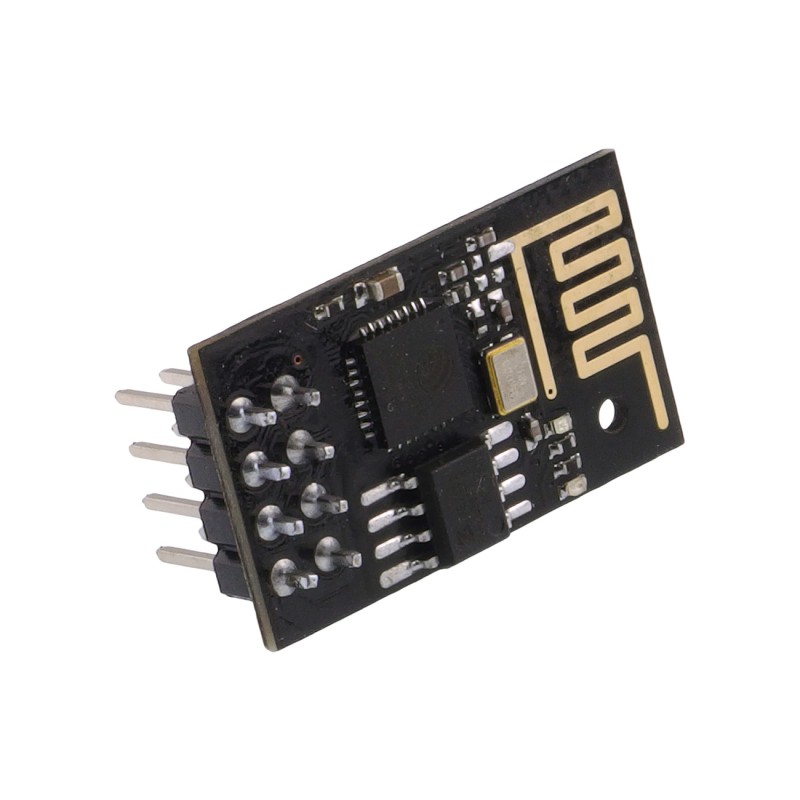
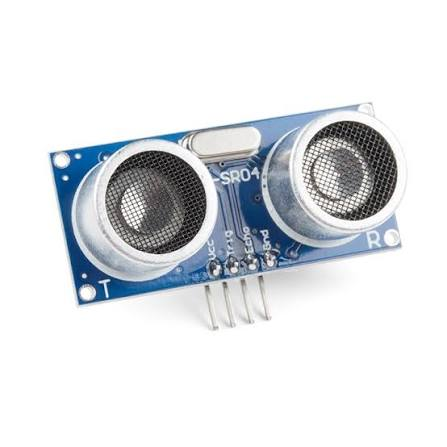
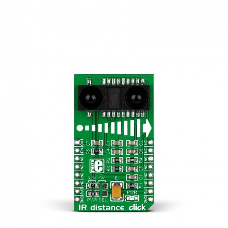
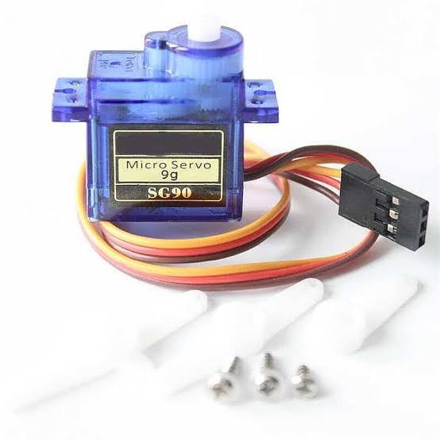
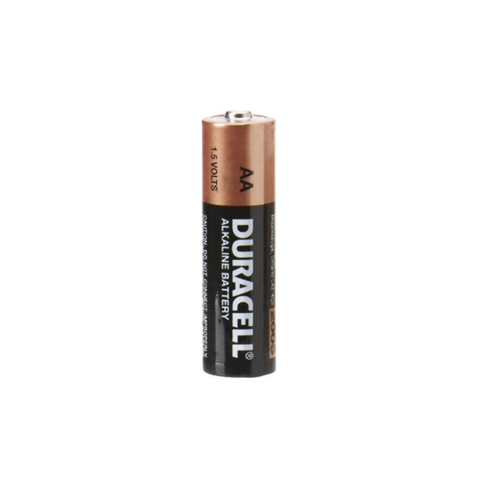

# Spisak komponenti
 
**Projekat:** Autonomna mobilna platforma sa integrisanim elektromagnetskim topom
**Verzija:** 0.10 (nacrt)
**Svrha:** Pregled svih komponenti sistema sa slikom, namjenom i osnovnim podacima. Detalji o pinovima su u `hwsw-interface.md`, a o napajanju i blokovima u `hardware.md`.
 
**Slike:** fotografije se stavljaju u folder `docs/images/` pod nazivom iz oznake slike uz komponentu. Dok slika ne postoji, prikazuje se prazan okvir.
 
Vrijednosti označene sa **TBD** treba potvrditi.
 
---
 
## 1. Glavne komponente
 
### 1.1 Mikrokontroler: PIC24FJ64GA702
 

 
| Svojstvo | Vrijednost |
|---|---|
| Namjena | Upravljanje cijelim sistemom, mašine stanja |
| Kućište | SOIC-28 |
| Napon | 3.3 V |
| Interfejsi | I2C, UART, ADC, GPIO |
| Status | Potvrđeno |
| Dokumentacija | [Datasheet (porodica PIC24FJ256GA705)](https://ww1.microchip.com/downloads/aemDocuments/documents/MCU16/ProductDocuments/DataSheets/PIC24FJ256GA705-Family-Data-Sheet-DS30010118E.pdf) |
 
### 1.2 WiFi modul: ESP-01 (ESP8266)
 

 
| Svojstvo | Vrijednost |
|---|---|
| Namjena | Veza sa PC aplikacijom (WiFi, TCP) |
| Napon | 3.3 V |
| Interfejs | UART, 9600 baud, AT komande (AT firmver 1.7.4); reset preko ESP_RST (RB10) |
| Priprema | Programira se **prije ugradnje** (upis AT firmvera 1.7.4 i brzine 9600 baud), jer na ploči nema konektora za programiranje ESP-a (`hwsw-interface.md`, 7.0) |
| Napomena | Veća struja pri slanju, procjena do oko 300 mA vršno (izmjeriti, **TBD**) |
| Status | Potvrđeno |
| Dokumentacija | [Datasheet](https://www.alldatasheet.com/datasheet-pdf/view/1179098/ETC2/ESP-01.html) |
 
### 1.3 Senzor za prepreke: HC-SR04
 

 
| Svojstvo | Vrijednost |
|---|---|
| Namjena | Detekcija prepreka (niski senzor na šasiji) |
| Napon | 5 V |
| Interfejs | TRIG (ulaz), ECHO (izlaz). Na našoj ploči TRIG ide preko R18, a ECHO preko R13. TRIG linija je u mirovanju na oko 5 V; ECHO stiže na P12 preko čipa W1 na JoyCar ploči, na oko 3.3 V |
| Priključak | JoyCar US zaglavlje (P8 TRIG, P12 ECHO) |
| Status | Potvrđeno |
| Dokumentacija | [Datasheet](https://cdn.sparkfun.com/datasheets/Sensors/Proximity/HCSR04.pdf) |
 
### 1.4 Senzor za metu: IR Distance Click
 

 
| Svojstvo | Vrijednost |
|---|---|
| Proizvođač | MikroElektronika |
| Senzor | Sharp GP2Y0A60SZ0F |
| Namjena | Detekcija mete, na kuli. Opseg po datasheetu 10–150 cm; izmjereno pouzdano otkrivanje do oko 80 cm, praćenje do oko 50 cm (`hwsw-interface.md`, 3.1) |
| Napon | 3.3 V (jumperi PWR SEL na 3V3) |
| Interfejs | Analogni izlaz OUT, pin EN |
| Status | Potvrđeno |
| Dokumentacija | [Datasheet](https://download.mikroe.com/documents/datasheets/GP2Y0A60SZxF.pdf) |
 
### 1.5 Okretna kula (servo motor SG90)
 

 
| Svojstvo | Vrijednost |
|---|---|
| Namjena | Okretanje kule sa topom, metom i senzorom za metu |
| Tip | SG90 (modelarski servo) |
| Interfejs | PWM 50 Hz, JoyCar izlaz za servo (P1) |
| Opseg okretanja | Izmjereno oko 90° (impulsi 0,5–2,5 ms), dakle oko 45° lijevo i desno od sredine (`hwsw-interface.md`, 3.2). Van tog opsega meta se traži kretanjem vozila (zahtjev FR-05) |
| Napajanje | Sa JoyCar zaglavlja Servo 1, izmjereno oko 6.4 V (V_BAT). Granica napona SG90 **TBD**. Struja u pokretu oko 12–25 mA prosječno (na 5 V, bez opterećenja) |
 
### 1.6 JoyCar platforma
 
| Svojstvo | Vrijednost |
|---|---|
| Proizvođač | Joy-IT |
| Sadržaj | Šasija, motori, ploča sa drajverima motora, senzori (linija, prepreke, brzina), držač baterija |
| I2C uređaji | PWM kontroler 0x70, IO ekspander 0x38 |
| Napajanje | 4 × AA, ulaz 4.5–9 V, prekidač ON/OFF |
| Zaglavlje | 3v3, 5V, V_BAT, V_LED, GND, EOUT7 |
| Namjena | Pogon i izvor napajanja za cijeli sistem |
 
### 1.7 Baterije: 4 × AA
 

 
| Svojstvo | Vrijednost |
|---|---|
| Namjena | Jedini izvor napajanja za cijeli sistem |
| Napon | Oko 4–6.4 V (4 × 1.5 V) |
| Napomena | Pad napona pod opterećenjem, vidi `hardware.md`, odjeljak 4.3 |
 
### 1.8 Elektromagnetski top (coilgun)
 
| Svojstvo | Vrijednost |
|---|---|
| Namjena | Ispaljivanje projektila, na kuli |
| Signali | TOP_CHARGE, TOP_FIRE, CAP_V, TOP_RESERVE na konektoru J2 (vidi `hwsw-interface.md`, odjeljak 5) |
| Status | **Još nije isporučen**, rezervisan konektor i pinovi |
 
---
 
## 2. Naša ploča (PCB)
 
| Oznaka | Dio | Opis | Napomena |
|---|---|---|---|
| J5 | Ivični konektor (zlatni prsti) | Zamjenjuje micro:bit u utoru JoyCar ploče, 9 kontakata | 1.6 mm, ENIG, raspored sa micro:bita; jezičak 51.6 mm, dubina 7.62 mm, prsti 1.0 × 7.0 mm (iz datasheeta utora, potvrđeno papirnom probom, zazor oko 1 mm) |
| J6 | Priključak napajanja | +3.3V, +5V, VBAT, GND sa JoyCar zaglavlja | Pinski konektor 1 × 4 |
| J3 | Programski konektor | MCLR, +3.3V, GND, PGD1, PGC1 | Pinski konektor 1 × 5, za PICkit 3 (isti raspored) |
| J4 | Debug konektor | DEBUG_TX, GND | Pinski konektor 1 × 2 |
| U1 | ESP-01 | WiFi modul | Utičnica 2 × 4 |
| J1 | IR Distance Click | +3.3V, GND, IR_OUT, IR_EN | Pinski konektor 1 × 4 |
| J2 | Konektor topa | VBAT, GND, TOP_CHARGE, TOP_FIRE, CAP_V, TOP_RESERVE | Pinski konektor 1 × 6, rezervisano |
| JP1 | Kratkospojnik | Odvajanje napajanja topa | Pinski konektor 1 × 2 |
| TP1–TP7 | Test tačke | VBAT, UART_TX, UART_RX, SDA, SCL, +3.3V, GND | Pad 1.5 mm (TP7: pločica 2.0 mm sa rupom 1.0 mm) |
 
---
 
## 3. Dijelovi ploče (prema šemi)
 
Izvor: šema `Vihor.kicad_sch`, list „Moduli“ (KiCad 10.0.8), stanje nakon PR #54 (27.11.2026). Ukupno **45 dijelova**, od toga **4 neugrađena (DNP)**. Dijelovi su grupisani prema blokovima na listu „Moduli“.

Oznake: **DNP** = neugrađeno (mjesto na ploči postoji, dio se ne lemi). **TBD** = vrijednost još nije određena.

### 3.1 WiFi modul

| Oznaka | Vrijednost | Footprint | Namjena |
|---|---|---|---|
| U1 | ESP8266-01 (ESP-01) | ESP8266:XCVR_ESP8266-01_ESP-01 | WiFi modul, UART prema PIC-u (UART_TX, UART_RX) |
| R1 | 10k | Resistor_SMD:R_0805_2012Metric | Pull-up na EN (CH_PD) |
| R2 | 10k | Resistor_SMD:R_0805_2012Metric | Pull-up na RST; mreža ESP_RST ide na RB10 |
| R6 | 10k | Resistor_SMD:R_0805_2012Metric | Pull-up na IO0 (normalno pokretanje) |
| R8 | 10k | Resistor_SMD:R_0805_2012Metric | Pull-up na IO2 (normalno pokretanje) |
| C1 | 100 µF | Capacitor_THT:CP_Radial_D6.3mm_P2.50mm | Elektrolitski (polarizovani) kondenzator uz VCC, strujni šiljci pri slanju: Ø 6.3 mm, razmak nožica 2.5 mm, napon najmanje 10 V; + na +3.3V |
| C2 | 10 µF | Capacitor_SMD:C_0805_2012Metric | Blokiranje napajanja VCC |
| C3 | 100 nF | Capacitor_SMD:C_0805_2012Metric | Blokiranje napajanja VCC |

### 3.2 Ivični konektor

| Oznaka | Vrijednost | Footprint | Namjena |
|---|---|---|---|
| J5 | Conn_01x09 | vihor:MicroBit_EdgeFingers_9 | Zlatni prsti za micro:bit utor. Pinovi 1–9: GND, SDA, SCL, EDGE_3V, BUZZER, VBAT_SENSE (preko R11), ECHO (preko R13), TRIG (preko R18), SERVO_PWM |
| R11 | 0 Ω | Resistor_SMD:R_0805_2012Metric | Serijski na liniji napona baterije (P2 → VBAT_SENSE); gornji otpornik opcionog djelitelja |
| R12 | 10k, **DNP** | Resistor_SMD:R_0805_2012Metric | VBAT_SENSE prema GND; donji otpornik opcionog djelitelja. Ne ugrađuje se: napon na P2 je izmjeren i ispod 3.3 V |
| R13 | 1k | Resistor_SMD:R_0805_2012Metric | Serijska zaštita ulaza ECHO (RB7) |
| R14 | 10k, **DNP** | Resistor_SMD:R_0805_2012Metric | I2C pull-up na SDA; ne ugrađuje se jer JoyCar već ima pull-up |
| R16 | 10k, **DNP** | Resistor_SMD:R_0805_2012Metric | I2C pull-up na SCL; ne ugrađuje se jer JoyCar već ima pull-up |
| R17 | 0 Ω, **DNP** | Resistor_SMD:R_0805_2012Metric | Premosnica EDGE_3V → +3.3V; ne ugrađuje se dok se ne provjeri smjer napajanja na kontaktu 3V |
| R18 | 1k | Resistor_SMD:R_0805_2012Metric | Serijski otpornik na TRIG (J5 pin 8 → RB6); linija je u mirovanju na oko 5 V |

### 3.3 MCU i napajanje

| Oznaka | Vrijednost | Footprint | Namjena |
|---|---|---|---|
| IC1 | PIC24FJ64GA702-I/SO | PIC:SOIC127P1030X265-28N | Mikrokontroler |
| C4 | 100 nF | Capacitor_SMD:C_0805_2012Metric | Blokiranje VDD (pin 13) |
| C5 | 10 µF | Capacitor_SMD:C_0805_2012Metric | Kondenzator jezgre VCAP (pin 20) |
| C6 | 100 nF | Capacitor_SMD:C_0805_2012Metric | Blokiranje AVDD (pin 28) |
| C7 | 10 µF | Capacitor_SMD:C_0805_2012Metric | Između +3.3V i GND uz konektor J6, gdje napon 3.3 V ulazi na ploču |
| R10 | 10k | Resistor_SMD:R_0805_2012Metric | Pull-up na MCLR |
| J3 | Conn_01x05 | Connector_PinHeader_2.54mm:PinHeader_1x05_P2.54mm_Vertical | Programski konektor (ICSP): 1 MCLR, 2 +3.3V, 3 GND, 4 PGD1, 5 PGC1 |
| J6 | Conn_01x04 | Connector_PinHeader_2.54mm:PinHeader_1x04_P2.54mm_Vertical | Napajanje sa JoyCar zaglavlja: 1 +3.3V, 2 +5V, 3 VBAT, 4 GND |
| J4 | Conn_01x02 | Connector_PinHeader_2.54mm:PinHeader_1x02_P2.54mm_Vertical | Debug konektor: 1 DEBUG_TX (RB11), 2 GND |
| SW1 | SW_Push | Button_Switch_THT:SW_PUSH_6mm | Dugme START/STOP (mreža BTN, RB5) |
| R15 | 10k | Resistor_SMD:R_0805_2012Metric | Pull-up dugmeta (BTN) |
| D2 | LED | LED_SMD:LED_0805_2012Metric | Statusna LED (RA2) |
| R9 | 1k | Resistor_SMD:R_0805_2012Metric | Otpornik za ograničenje struje LED-a |
| TP1 | TestPoint | TestPoint:TestPoint_Pad_D1.5mm | Test tačka VBAT |
| TP2 | TestPoint | TestPoint:TestPoint_Pad_D1.5mm | Test tačka UART_TX |
| TP3 | TestPoint | TestPoint:TestPoint_Pad_D1.5mm | Test tačka UART_RX |
| TP4 | TestPoint | TestPoint:TestPoint_Pad_D1.5mm | Test tačka SDA |
| TP5 | TestPoint | TestPoint:TestPoint_Pad_D1.5mm | Test tačka SCL |
| TP6 | TestPoint | TestPoint:TestPoint_Pad_D1.5mm | Test tačka +3.3V |
| TP7 | TestPoint | TestPoint:TestPoint_THTPad_D2.0mm_Drill1.0mm | Test tačka GND |

### 3.4 Senzori i top

| Oznaka | Vrijednost | Footprint | Namjena |
|---|---|---|---|
| J1 | Conn_01x04 | Connector_PinHeader_2.54mm:PinHeader_1x04_P2.54mm_Vertical | Konektor IR Distance Click: 1 +3.3V, 2 GND, 3 IR_OUT (RB2), 4 IR_EN (RB3) |
| J2 | Conn_01x06 | Connector_PinHeader_2.54mm:PinHeader_1x06_P2.54mm_Vertical | Konektor topa: 1 VBAT (preko F1 i JP1), 2 GND, 3 TOP_CHARGE, 4 TOP_FIRE, 5 CAP_V, 6 TOP_RESERVE |
| F1 | **TBD** | Fuse:Fuse_1206_3216Metric | Osigurač na VBAT prema topu (vrijednost zavisi od struje topa) |
| JP1 | Kratkospojnik (pinski konektor 1 × 2 sa kapicom) | Connector_PinHeader_2.54mm:PinHeader_1x02_P2.54mm_Vertical | Spajanje i odvajanje napajanja topa: sa kapicom VBAT ide na top, bez kapice je top odvojen |
| R3 | 10k | Resistor_SMD:R_0805_2012Metric | Pull-down na TOP_CHARGE (RA3) |
| R4 | 10k | Resistor_SMD:R_0805_2012Metric | Pull-down na TOP_FIRE (RA4) |
| R5 | **TBD** | Resistor_SMD:R_0805_2012Metric | Gornji otpornik djelitelja CAP_V → VCAP_SENSE (RA0) |
| R7 | **TBD** | Resistor_SMD:R_0805_2012Metric | Donji otpornik djelitelja (VCAP_SENSE prema GND) |
| D1 | **TBD** | Diode_SMD:D_SOD-123 | Zener dioda, zaštita ulaza VCAP_SENSE (RA0) |

### 3.5 Sažetak

| Vrsta | Količina | Oznake |
|---|---|---|
| Otpornici | 18 (4 DNP) | R1–R18 |
| Kondenzatori | 7 | C1–C7 |
| Diode | 2 | D1 (zener), D2 (LED) |
| Konektori | 6 | J1–J6 |
| Kratkospojnik | 1 | JP1 |
| Osigurač | 1 | F1 |
| Dugme | 1 | SW1 |
| Test tačke | 7 | TP1–TP7 |
| Integrisana kola i moduli | 2 | IC1, U1 |
| **Ukupno** | **45** | |
 
Alat koji nije dio ploče: programator **PICkit 3**, spaja se na J3 (isti raspored pinova). Pri programiranju se ploča napaja sa JoyCar ploče, a ne iz programatora.
 
---
 
## 4. Pregled napajanja i interfejsa
 
| Komponenta | Napon | Interfejs | Pinovi PIC-a |
|---|---|---|---|
| ESP-01 | 3.3 V | UART, reset | RB12, RB13, RB10 |
| HC-SR04 | 5 V | TRIG, ECHO | RB6, RB7 |
| IR Distance Click | 3.3 V | OUT, EN | RB2, RB3 |
| Servo kule (SG90) | oko 6.4 V sa zaglavlja Servo 1 (granica napona SG90 **TBD**) | PWM | RB14 |
| JoyCar (motori, senzori) | V_BAT | I2C | RB8, RB9 |
| Top | **TBD** | TOP_CHARGE, TOP_FIRE, CAP_V (preko djelitelja), TOP_RESERVE | RA3, RA4, RA0, RB4 |
| Baterija (mjerenje) | | ADC, JoyCar P2 | RA1 |
| Dugme START/STOP (SW1) | 3.3 V | Digitalni ulaz | RB5 |
| Statusna LED (D2) | 3.3 V | Digitalni izlaz | RA2 |
| Zujalica (JoyCar P16) | | Digitalni izlaz | RB15 |
| Debug konektor (J4) | 3.3 V | UART TX | RB11 |
| PICkit 3 (J3) | Ploča napajana sa JoyCar ploče | ICSP | MCLR, RB0, RB1 |
